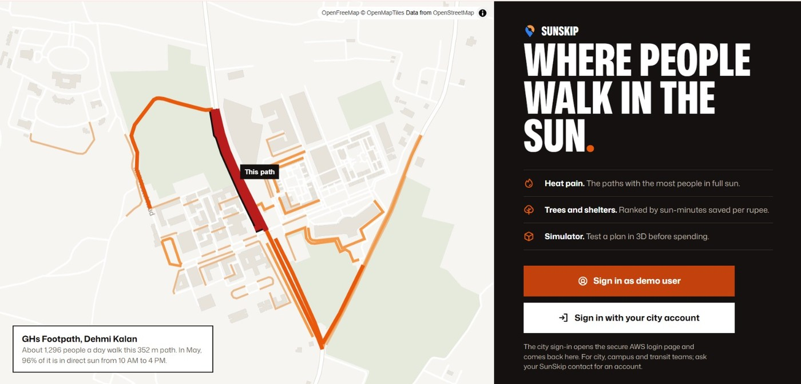
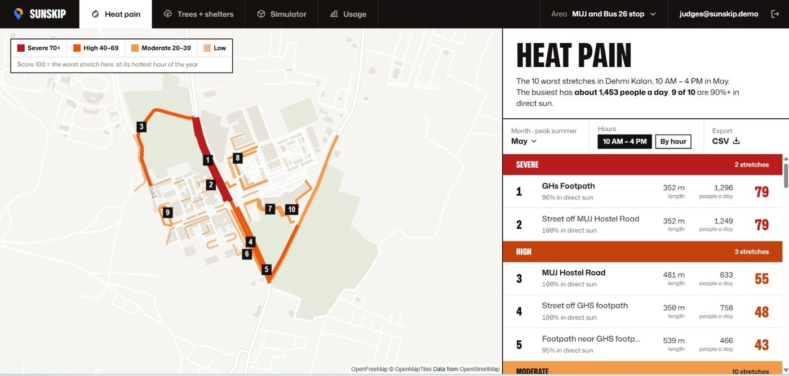
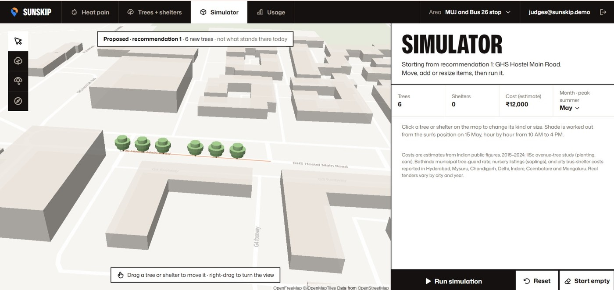
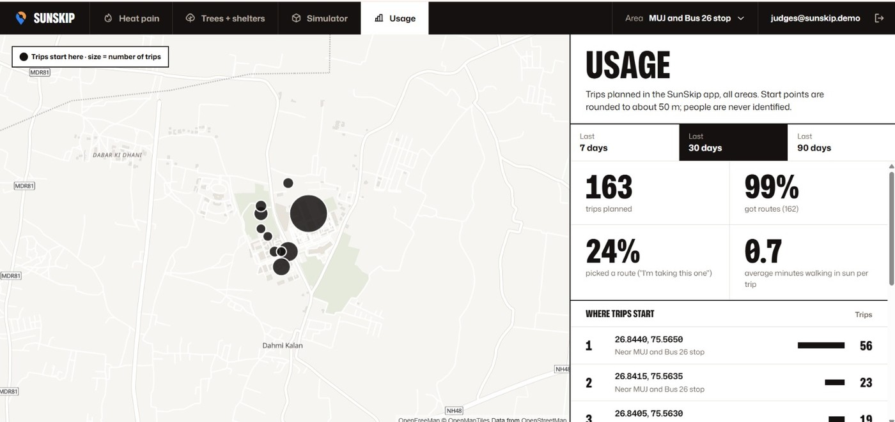
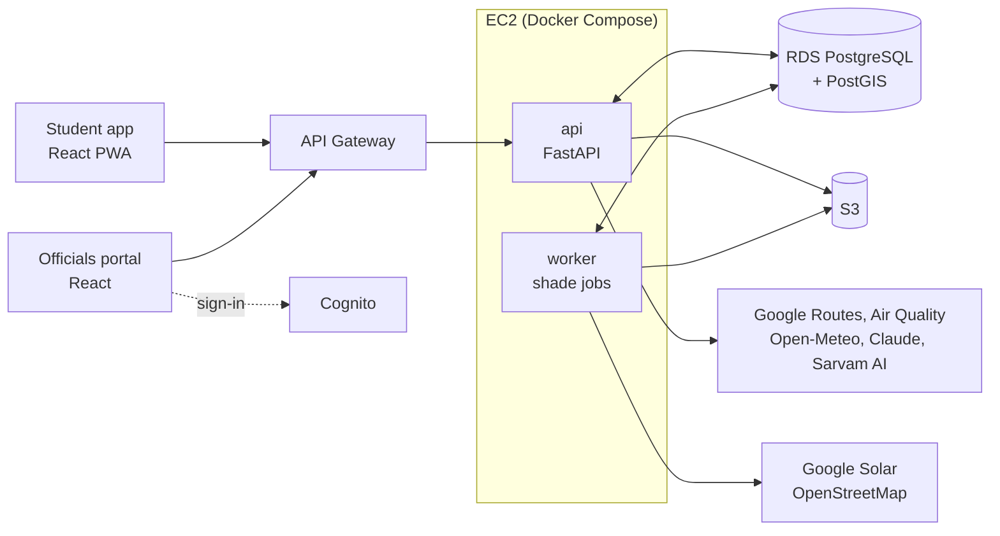

# &nbsp;&nbsp;<sub>Skip the sun, not the trip.</sub>

## Introduction

SunSkip helps people in India reach their destination with less time in direct sun. It finds routes on foot, by bus, metro or e-rickshaw that minimise sun exposure, and suggests the best time to leave. Alongside it, an officials portal turns the same data into decisions, showing city teams which footpaths leave the most people exposed and where new trees or shelters would do the most good.

**The problem**

- For many commuters, the hottest part of the day is the walk to and from the bus or metro.
- At midday in May the sun over Jaipur stands at about 82°, so a 10 m building casts a shadow only 1.4 m long. Buildings offer almost no relief; only trees, shelters and timing do.
- Navigation apps optimise for distance and time, with no notion of sun or shade, and city planners have no data on where shade is missing or who it would help.

**The pilot walk**

Our test route is the 810 m walk from the main gate of Manipal University Jaipur (MUJ) to the Bus 26 stop, about 11.3 minutes on foot. Minutes in direct sun on 15 May:

| Leave at | 7 AM | 10 AM | 1 PM | 4 PM | 5 PM | 6 PM |
| --- | --- | --- | --- | --- | --- | --- |
| Minutes in sun | 5.6 | 11.3 | 11.3 | 9.5 | 7.6 | 4.6 |

At 1 PM the entire walk is in the sun. Leaving at 5 PM cuts this to 7.6 minutes, and at 6 PM to 4.6.

**Student app**

- Ranks routes by minutes in direct sun, alongside total time, fare and distance on foot.
- Recommends the best hour to leave, from 7 AM to 7 PM.
- Shows a shade map for any hour, with feels-like temperature, air quality and a heat alert at 40 °C.
- Provides turn-by-turn navigation with rerouting, plus an AR view that draws arrows on the path through the camera: blue in shade, orange in sun.
- Answers trip questions by text or voice in Hindi or English, and speaks walking directions in Hindi.
- Installs to the home screen as a PWA.

**Officials portal**

- **Heat pain:** ranks footpath stretches by how many people walk them and how much of each is in the sun.
- **Trees and shelters:** recommends placements ranked by sun minutes saved per rupee, with estimated costs.
- **Simulator:** place trees and shelters on a 3D map and compare shade before and after.
- **Usage:** trips planned, routes chosen and where trips start.

**Live links**

| | Link |
| --- | --- |
| Student app (mobile) | https://main.d2p3yf0fdqcxbz.amplifyapp.com |
| Officials portal (desktop; demo user available on the sign-in page) | https://main.d2amqkpwwnkri3.amplifyapp.com |

## Project images

<p align="center"><br><em>Sign-in page, highlighting one footpath in the pilot area.</em></p>

<p align="center"><br><em>Heat pain: the worst stretches around MUJ for May, 10 AM to 4 PM.</em></p>

<p align="center"><br><em>Simulator: six proposed trees along one road, with estimated cost.</em></p>

<p align="center"><br><em>Usage: trips planned over the last 30 days and where they start.</em></p>

## Tech stack and architecture



| Layer | Technologies |
| --- | --- |
| Backend | Python 3.12, FastAPI, PostgreSQL 16 + PostGIS |
| Front ends | React 19, TypeScript, Vite, Tailwind CSS, MapLibre GL; three.js and LocAR for AR |
| AI and voice | Claude, Sarvam AI |
| AWS | EC2, RDS, S3, API Gateway, Cognito, Amplify, Secrets Manager |

**How it works**

- **Shade data:** Google's Solar API provides hourly shade. SunSkip divides the map into small cells and stores twelve monthly shade files per cell.
- **Scoring:** for each walk from Google Routes, shade is sampled every 5 m as the clock advances at walking speed. Routes are ranked by heat dose (sun minutes weighted by how hot each hour feels), time and fare.
- **New areas:** requests never wait for shade data. The API returns plain routes immediately while a background worker fetches shade; the app polls and re-ranks once it's ready. Where Google has no data, sun minutes show as "unknown".
- **Portal:** a nightly job estimates foot traffic on each path from a simple transport model and routes chosen in the app, and a shadow simulation tests proposed trees and shelters.

## Project setup

Requires Git, Python 3.12, Node 22 and Docker. Commands are for bash; on Windows PowerShell use `py -3.12 -m venv .venv`, `.\.venv\Scripts\Activate.ps1` and `copy` instead of `cp`.

**API**

```bash
cd api
python3.12 -m venv .venv && source .venv/bin/activate
pip install -r requirements.txt
cp .env.example .env
docker compose -f docker-compose.dev.yml up -d --wait   # database on port 5433
python -m scripts.migrate                               # create tables
uvicorn app.main:app --reload                           # http://127.0.0.1:8000/docs
```

- **Sample data (no keys):** set `USE_FAKES=true` in `.env` to get fixed responses for the pilot walk.
- **Real data:** set `GOOGLE_API_KEY` and `USE_FAKES=false`, run `python -m app.worker` in a second terminal, then `python -m scripts.preload --area muj`.

**Student app**

```bash
cd app
npm install
cp .env.example .env
npm run dev          # https://localhost:5173 (accept the local certificate warning)
```

Runs in mock mode by default. To use the live API, set `VITE_USE_MOCKS=false` and `API_PROXY_TARGET=https://7mhceh7sl0.execute-api.ap-southeast-2.amazonaws.com` in `.env`; omit `API_PROXY_TARGET` to use a local API.

**Officials portal**

```bash
cd portal
npm install
cp .env.example .env
npm run dev          # http://localhost:5174
```

Runs in mock mode by default; set `VITE_COGNITO_CLIENT_ID=` (empty) in `.env` to skip sign-in. For the live API, set `VITE_USE_MOCKS=false` and the same `API_PROXY_TARGET`, and keep the Cognito values (a portal account is required).

**Before pushing**, run these from the repository root (CI runs the same checks):

```bash
(cd api && ruff check . && ruff format --check .)
(cd app && npm run build)
(cd portal && npm run build)
```
