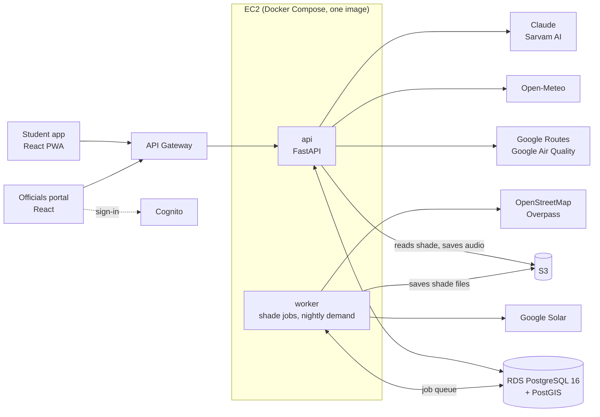

# SunSkip

**Skip the sun, not the trip.**

## Introduction

SunSkip is a trip planner that ranks routes by how many minutes you spend in direct sun. It covers walking, bus, metro and e-rickshaw trips, and it tells you the best time to leave. A second product, the officials portal, uses the same data to show city teams which footpaths put the most people in the sun. We built it at a hackathon in October 2026.

**The problem**

- In an Indian summer, the walk to the bus or metro is the part of a trip spent in full sun.
- At midday in May the sun over Jaipur is almost straight overhead (about 82° up). A 10 m building then throws a shadow only about 1.4 m long. Buildings give almost no shade at that hour. Only trees, shelters and timing help.
- Map apps show the shortest walk. They know nothing about sun or shade. City officials have no data on where shade is missing.

**The pilot walk**

Our test walk is the 810 m from the main gate of Manipal University Jaipur (MUJ) to the Bus 26 stop. It takes 11.3 minutes at walking pace. This is how many of those minutes are in direct sun on 15 May:

| Leave at | 7 AM | 10 AM | 1 PM | 4 PM | 5 PM | 6 PM |
| --- | --- | --- | --- | --- | --- | --- |
| Minutes in sun | 5.6 | 11.3 | 11.3 | 9.5 | 7.6 | 4.6 |

At 1 PM the whole walk is in the sun. Leaving at 5 PM cuts that to 7.6 minutes, and leaving at 6 PM cuts it to 4.6.

**What the student app does**

- Ranks each route by minutes in direct sun, next to total time, fare and metres on foot.
- Shows the best hour to leave, from 7 AM to 7 PM.
- Shows a shade map (the streets around you coloured by sun or shade for any hour), plus the feels-like temperature and air quality, with a heat alert at 40 °C or more.
- Guides you on a map, and finds a new route after a wrong turn. An AR (augmented reality) view draws arrows on the path through the phone camera, blue in shade and orange in sun.
- Answers questions about your trip by text or voice, in Hindi or English, and speaks walking directions in Hindi.
- Installs on a phone's home screen. A number we don't know is shown as "unknown", never as 0.

**What the officials portal does**

- **Heat pain:** ranks footpath stretches by how many people walk them and how much of the path is in the sun.
- **Trees + shelters:** suggests where to plant trees or build shelters, ranked by sun minutes saved per rupee. Costs are estimates.
- **Simulator:** place trees and shelters on a 3D map and see the shade before and after.
- **Usage:** how many trips were planned, how many led to a chosen route, and where trips start.

**Live links**

| What | Link |
| --- | --- |
| Student app (open on a phone) | https://main.d2p3yf0fdqcxbz.amplifyapp.com |
| Officials portal (open on a laptop; the sign-in page has a demo user button) | https://main.d2amqkpwwnkri3.amplifyapp.com |
| API health check | https://7mhceh7sl0.execute-api.ap-southeast-2.amazonaws.com/v1/health |

**Team:** P1, Suryansh: the API and the officials portal. P2, Tejas Mehra: the agent (Ask SunSkip) and voice. P3, Dhruv: the student app and the AR walk view.

## Project images

These four screens are from the officials portal. Click an image to see it full size.

<p align="center"><br><em>Sign-in page. The map picks out one footpath in the pilot area and says how many people walk it and how much of it is in the sun.</em></p>

<p align="center"><br><em>Heat pain. The ten worst stretches around MUJ for May, 10 AM to 4 PM, ranked by score.</em></p>

<p align="center"><br><em>Simulator. Six proposed trees along one road, with their estimated cost, ready to run.</em></p>

<p align="center"><br><em>Usage. Trips planned in the last 30 days, how many led to a chosen route, and where trips start.</em></p>

## Tech stack and architecture



| Part | Built with |
| --- | --- |
| API and worker (`api/`) | Python 3.12, FastAPI, PostgreSQL 16 with PostGIS (its map extension), NumPy, rasterio, Shapely |
| Student app (`app/`) and portal (`portal/`) | Vite 7, React 19, TypeScript 5.9, Tailwind CSS 4, React Router 7, MapLibre GL 5 maps. The app adds three.js and LocAR for the AR view, and vite-plugin-pwa, which makes it installable (a PWA) |
| Agent and voice | Claude for answers; Sarvam AI for speech-to-text, translation and the Hindi voice |
| Outside data | Google Routes, Google Solar, Google Air Quality, Open-Meteo (weather), OpenStreetMap (footpaths and places) |

| AWS service (all in region `ap-southeast-2`) | Used for |
| --- | --- |
| EC2 | Runs the API and the worker in Docker |
| RDS | The PostgreSQL database, which also holds the job queue |
| S3 | Shade files and saved voice audio |
| API Gateway | The public HTTPS address, and the sign-in check for portal requests |
| Cognito | Portal sign-in |
| Amplify Hosting | Serves the student app and the portal |
| Secrets Manager, IAM, Systems Manager | API keys, server permissions and deploys |

**How it works**

- **Shade data.** Google's Solar API says which spots are in shade for each hour of the day. SunSkip cuts the map into small squares called cells and keeps twelve shade files per cell, one per month.
- **Scoring a walk.** Google Routes gives the bus, metro and walking routes. For each walk the API reads the shade every 5 m, moving the clock forward at walking speed (1.2 m/s).
- **Ranking.** Options are ranked by heat dose (sun minutes weighted by how hot that hour feels), total time and fare. Up to six are returned.
- **New areas.** A request never waits for shade data. If an area has none yet, the API answers at once with plain routes, and a background worker fetches the shade. The app checks every 3 seconds, then shows the routes ranked by sun. Where Google has no shade data, sun minutes show as "unknown". Google Solar calls are capped at 6,500 a month.
- **Portal.** A nightly job estimates how many people walk each path. It uses a small transport model: walking trips between mapped places such as hostels, stops and shops, each walked along the shortest path. Routes people chose in the app are counted too. The portal ranks stretches with that, and tests new trees and shelters with a shadow simulation.

## Project setup

You need Git, Python 3.12, Node 22 and Docker. Commands are for bash. On Windows PowerShell use `py -3.12 -m venv .venv`, `.\.venv\Scripts\Activate.ps1`, and `copy` in place of `cp`.

**API**

```bash
cd api
python3.12 -m venv .venv && source .venv/bin/activate
pip install -r requirements.txt
cp .env.example .env
docker compose -f docker-compose.dev.yml up -d --wait   # the database, on port 5433
python -m scripts.migrate                               # creates the tables
uvicorn app.main:app --reload                           # http://127.0.0.1:8000/docs
```

- **Sample data, no keys:** set `USE_FAKES=true` in `.env`. Route plans, best times and weather then come back as fixed answers for the pilot walk (these are from an earlier measurement: 11.3 minutes at 1 PM, 7.4 at 5 PM).
- **Real data:** set `GOOGLE_API_KEY` and keep `USE_FAKES=false`. Start the worker with `python -m app.worker` in a second terminal, then load the pilot area with `python -m scripts.preload --area muj`.

**Student app**

```bash
cd app
npm install
cp .env.example .env
npm run dev          # https://localhost:5173 (the browser warns about the local certificate)
```

- **Mock mode** is the default (`VITE_USE_MOCKS=true`). The app runs on saved sample responses, so it needs no API.
- **Live API:** set `VITE_USE_MOCKS=false` and `API_PROXY_TARGET=https://7mhceh7sl0.execute-api.ap-southeast-2.amazonaws.com` in `.env`. Leave `API_PROXY_TARGET` out to use the API on your own machine.

**Officials portal**

```bash
cd portal
npm install
cp .env.example .env
npm run dev          # http://localhost:5174
```

- **Mock mode** is the default. Set `VITE_COGNITO_CLIENT_ID=` (empty) in `.env` to skip sign-in.
- **Live API:** set `VITE_USE_MOCKS=false` and the same `API_PROXY_TARGET`. Keep the Cognito values from `.env.example`. You need a portal account to sign in.

**Before you push**, run each line from the repository root. The same checks run on every pull request.

```bash
cd api && ruff check . && ruff format --check .   # code style for the API
cd app && npm run build                           # type check and build
cd portal && npm run build
```
