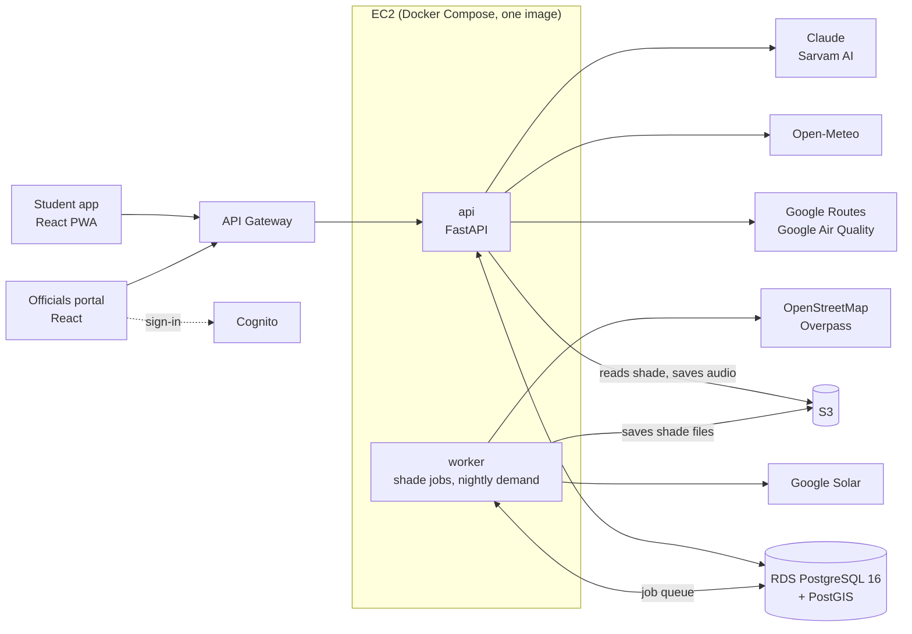

# SunSkip

**Skip the sun, not the trip.**

SunSkip plans walking, bus, metro and e-rickshaw trips by the minutes you spend in direct sun, anywhere in India that Google has shade data for, and tells you the best time to leave. A second product, the officials portal, uses the same data to show city teams which footpaths put the most people in the sun and where trees or shelters would help most.

It was built in a hackathon from 8 to 11 October 2026. The pilot area is Manipal University Jaipur (MUJ).

## Live

| What | Link |
| --- | --- |
| Student app (open on a phone; installable) | https://main.d2p3yf0fdqcxbz.amplifyapp.com |
| Officials portal (desktop; the sign-in page has a demo user button) | https://main.d2amqkpwwnkri3.amplifyapp.com |
| API | https://7mhceh7sl0.execute-api.ap-southeast-2.amazonaws.com/v1 |
| API health | https://7mhceh7sl0.execute-api.ap-southeast-2.amazonaws.com/v1/health |
| Clickable design prototype | https://sunskip-ui.vercel.app |

## The problem

- In Indian summers the walk to and from the bus or metro is the part of a trip spent in full sun. Jaipur's average daily high in May is 40.5 °C (IMD).
- At midday in May the sun is almost overhead: 82° at MUJ on 15 May, so a 10 m building throws a 1.4 m shadow. Buildings give almost no shade then. Only trees, shelters and timing help.
- Google Maps shows the shortest walk and knows nothing about sun or shade. City officials have no data on where shade is missing.

Our pilot walk is the 810 m from the MUJ main gate to the Bus 26 stop, the main bus out of campus. Google's shade data, read every 5 m along it (163 points), gives this for 15 May:

| Hour (IST) | 7 | 8 | 9 | 10 | 11 | 12 | 13 | 14 | 15 | 16 | 17 | 18 |
| --- | --- | --- | --- | --- | --- | --- | --- | --- | --- | --- | --- | --- |
| Shade % | 50 | 25 | 7 | 0 | 0 | 0 | 0 | 4 | 7 | 15 | 34 | 61 |
| Minutes in sun | 5.6 | 8.5 | 10.6 | 11.3 | 11.3 | 11.3 | 11.3 | 10.9 | 10.6 | 9.6 | 7.4 | 4.4 |

- Leaving at 5 PM instead of 1 PM cuts direct sun from 11.3 to 7.4 minutes. The deployed API gives 11.3 at 1 PM and 7.6 at 5 PM, within ±0.2 of the table at every hour; [PRD §8](docs/PRD.md) explains the small gap.
- About 635 m of the walk is in sun every hour from 9 AM to 4 PM.
- The worst stretch is about 430 m with no shade at all, on the GHS footpath. It is the portal's first tree recommendation.

## What it does

### Student app (`app/`)

- **Routes ranked by sun.** Each option shows minutes walking in direct sun, minutes waiting at stops in the sun, total time, fare and metres on foot. Options are labelled Recommended, Fastest, Cheapest and Coolest.
- **Best time to leave.** Minutes in sun for each hour from 7 AM to 7 PM, for the trip or for one walk.
- **Shade map.** Streets around you coloured by sun or shade for any hour.
- **Heat banner.** Feels-like temperature and India's air quality index (NAQI), with a heat alert at feels-like 40 °C or more.
- **E-rickshaw swaps** for long or hot walks inside drawn zones (MUJ and the Jaipur metro station areas). Fares come from a formula and are always labelled as estimates.
- **Navigation** on a map that follows you, with rerouting after a wrong turn.
- **AR walk view.** Chevrons drawn on the path through the camera: blue in shade, orange in sun, grey where shade is unknown. With weak GPS it switches to a 2D compass arrow, and a one-arrow screen takes over when the camera can't be used.
- **Destination search** over named places near you from OpenStreetMap, with a Google lookup and pick-on-map as fallbacks.

It is phone-first and installs as a PWA. An unknown number is shown as "unknown", never as 0, and estimates are labelled.

### Ask SunSkip and voice

- **Ask SunSkip** answers questions about your trip by text or voice, in Hindi or English. The agent (Claude) can only use four tools that run the app's own route, best-time and weather logic. Every number in its answer is checked against what the tools returned; an answer that fails the check is replaced by a short one built from the trip's numbers.
- **Spoken directions in Hindi** while you walk, prepared before the walk starts so each step plays on time.
- Speech-to-text, translation and the voice come from Sarvam AI. If the server voice is not available, the browser's own speech reads the directions.

Both are switched on by server settings (`AGENT_LIVE`, `VOICE_LIVE`); the app hides them when they are off.

### Officials portal (`portal/`)

- **Heat pain.** Footpath stretches ranked by how many people walk them, how much of the path is in sun and how hot those hours usually are, with CSV export.
- **Trees + shelters.** Recommendations for the worst stretches, ranked by sun-minutes saved per day per rupee, with estimated costs and a budget planner.
- **Stretch evidence.** A printable page for one stretch: a 12 month × 24 hour sun grid and where its walker estimate comes from.
- **Simulator.** Place trees and shelters on a 3D map and see the shade before and after, hour by hour.
- **Usage.** Trips planned, how many led to a chosen route, average minutes in sun per trip, and the top trip origins (rounded to about 50 m).

Sign-in is through Amazon Cognito.

### Anywhere in India, on demand

Shade data is fetched the first time someone plans a trip through an area, then kept. See the next section.

## How it works

1. **Shade data.** Google's Solar API has an hourly shade layer at 1 m per pixel. SunSkip cuts the map into cells (about 150 × 140 m in Jaipur) and keeps twelve monthly shade files per cell in S3.
2. **Scoring a walk.** The API gets transit and walking routes from Google Routes. For each walk it reads the shade every 5 m, moving the clock forward at walking speed (1.2 m/s). It also searches OpenStreetMap footpaths for a shadier or clearly shorter path. Waiting at a stop counts by how sunny the stop is; a stop with unknown shade counts as full sun.
3. **Ranking.** Options are ranked by heat dose (sun minutes weighted by the feels-like temperature of that hour), time and fare. The best six are returned.
4. **Preparing shade.** A request never waits for shade data. If cells along a walk are missing, the API answers at once with plain routes, `shade.status: "PREPARING"` and a job id. A background worker downloads the shade files and the footpaths, and scores every path piece for every month and daylight hour. The app polls the job every 3 seconds for up to 2 minutes, then sends the same request again and shows the routes ranked by sun.
5. **No shade data.** Outside India, or where Google has none, routes still work, the best time is estimated from the sun's angle and the temperature, and sun minutes show as "unknown".
6. **Cost guard.** Each cell is fetched once, ever. Solar calls are capped at 6,500 a month (Google's free tier in India is 7,000), with at most 120 cells per job and 60 new cells per device per day.
7. **Portal.** A nightly job estimates walkers per path piece from nearby places and from the routes people chose in the app. The portal ranks stretches with that and tests trees and shelters with a shadow simulation.

The formulas are in [api.md §4](docs/api.md).

## Architecture



The api and the worker never call each other; they share the `shade_jobs` table in Postgres. Everything runs in AWS region `ap-southeast-2`:

| AWS service | Used for |
| --- | --- |
| EC2 | The api and worker containers |
| RDS (PostgreSQL 16 + PostGIS) | All data and the job queue |
| S3 | Shade files and cached voice audio |
| API Gateway (HTTP API) | Public HTTPS entry, Cognito token check on `/portal/*`, CORS, throttling |
| Cognito | Portal sign-in |
| Amplify Hosting | The two front ends |
| Secrets Manager | API keys, database URL, origin secret |
| IAM and Systems Manager | Server role and deploys, with no SSH access |

## Tech stack

| Part | Built with |
| --- | --- |
| API and worker | Python 3.12, FastAPI, Pydantic v2, asyncpg with plain SQL, NetworkX, NumPy, rasterio, Shapely, pyproj, pvlib, httpx, boto3 |
| Database | PostgreSQL 16 with PostGIS |
| Front ends | Vite 7, React 19, TypeScript 5.9, Tailwind CSS 4, React Router 7, axios, MapLibre GL 5 with OpenFreeMap tiles, Phosphor Icons |
| Student app only | three.js and LocAR for AR, vite-plugin-pwa |
| Agent and voice | Claude through the `anthropic` SDK; Sarvam AI for speech-to-text, translation and text-to-speech |
| Outside data | Google Routes, Google Solar, Google Air Quality, Open-Meteo, OpenStreetMap (Overpass) |
| CI | GitHub Actions: `ruff` for the API, `npm run build` for the app and the portal |

## Repository layout

```
api/        FastAPI app and the worker (app/), SQL migration (migrations/), scripts (scripts/)
app/        Student app: pages, components, and features/ar, features/agent, features/voice
portal/     Officials portal: pages, components, Cognito sign-in (src/auth.ts)
docs/       Product, tech, API, database and design docs
.github/    CI workflow
CLAUDE.md   Team rules and folder ownership
```

## Getting started

You need Git, Python 3.12, Node 22 and Docker. Commands are for bash; on Windows PowerShell use `py -3.12 -m venv .venv`, `.\.venv\Scripts\Activate.ps1` and `copy` in place of `cp`.

### API

```bash
cd api
python3.12 -m venv .venv && source .venv/bin/activate
pip install -r requirements.txt
cp .env.example .env
docker compose -f docker-compose.dev.yml up -d --wait   # Postgres + PostGIS on port 5433
python -m scripts.migrate
uvicorn app.main:app --reload                           # http://127.0.0.1:8000/docs
```

- **Sample data, no keys:** set `USE_FAKES=true` in `.env`. The plan, best-time and conditions endpoints then return fixed answers with the pilot walk's numbers.
- **Real data:** set `GOOGLE_API_KEY` (Routes, Solar and Air Quality APIs enabled) and `USE_FAKES=false`. Then run the worker and load the pilot area:

  ```bash
  python -m app.worker                 # in a second terminal
  python -m scripts.preload --area muj
  python -m scripts.seed_zones         # e-rickshaw zones
  python -m app.worker.demand          # walker estimates for the portal
  ```

- **Agent and voice:** set `ANTHROPIC_API_KEY`, `SARVAM_API_KEY`, `AGENT_LIVE=true` and `VOICE_LIVE=true`.

### Student app

```bash
cd app
npm install
cp .env.example .env
npm run dev          # https://localhost:5173 (self-signed certificate)
```

- **Mock mode** is the default (`VITE_USE_MOCKS=true`): the app runs on saved responses for the pilot trip, with no API.
- **Local API:** set `VITE_USE_MOCKS=false`. The dev server forwards `/v1` to `http://localhost:8000`.
- **Live API:** also set `API_PROXY_TARGET=https://7mhceh7sl0.execute-api.ap-southeast-2.amazonaws.com`.

Phone testing, the mock states and the AR desk mode are in [app/README.md](app/README.md).

### Officials portal

```bash
cd portal
npm install
cp .env.example .env
npm run dev          # http://localhost:5174
```

- **Mock mode** is the default. Leave `VITE_COGNITO_CLIENT_ID` empty to skip sign-in.
- **Local API:** set `VITE_USE_MOCKS=false` and keep `VITE_COGNITO_CLIENT_ID` empty. The token check happens in API Gateway, not in the API.
- **Live API:** set `VITE_USE_MOCKS=false`, `API_PROXY_TARGET` as above, and keep the Cognito values from `.env.example`. You need a portal account.

### Before you push

```bash
cd api && ruff check . && ruff format --check .
cd app && npm run build
cd portal && npm run build
```

CI runs the same checks on every pull request and every push to `main`. Deployment is described in [TRD §8](docs/TRD.md).

## Known limits

- Shade comes from Google's model, from imagery taken in 2025. Tree canopies are treated as solid and there are no field checks.
- Sun minutes exist only where Google has shade data, and only in India.
- Walkers per day are estimates until enough app trips come in. E-rickshaw fares and tree and shelter costs are estimates.
- The simulator is an approximation: no trunks, canopy gaps or growth time, and only paths within 60 m of an item are checked.
- SunSkip measures minutes in direct sun. It does not measure hot surfaces, wind or humidity, and gives no medical advice.

## Documentation

| Doc | What it covers |
| --- | --- |
| [docs/PRD.md](docs/PRD.md) | What we built and why, with the pilot data |
| [docs/TRD.md](docs/TRD.md) | Stack, code rules, setup, infrastructure and deployment |
| [docs/api.md](docs/api.md) | The 19 endpoints, data shapes and formulas |
| [docs/schema.md](docs/schema.md) | Database tables and the migration |
| [docs/design.md](docs/design.md) | Colours, type, map style and every screen |
| [docs/ui-screens.pdf](docs/ui-screens.pdf) | The 25 student app screens |
| [docs/PPT_README.md](docs/PPT_README.md) | A long walkthrough of every feature, written for the presentation |
| [app/README.md](app/README.md) | Running and testing the student app |
| [CLAUDE.md](CLAUDE.md) | Team rules |

## Team

| Role | Area |
| --- | --- |
| P1 (Suryansh) | `api/` (API, worker, database, AWS) and `portal/` |
| P2 | Agent and voice: `api/app/agent`, `api/app/voice`, `app/src/features/agent`, `app/src/features/voice` |
| P3 | The student app in `app/`, including the AR walk view |
