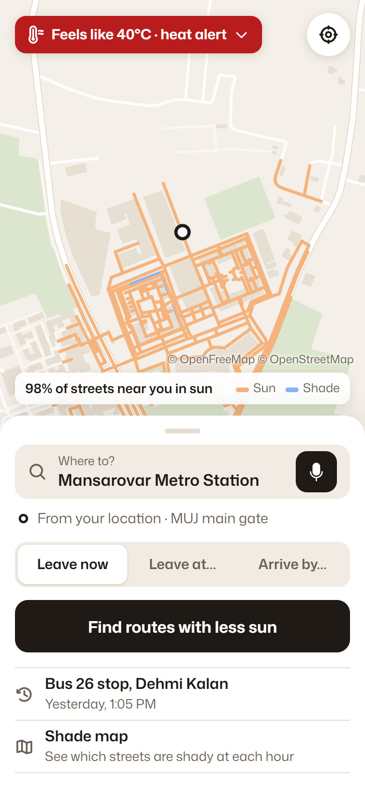
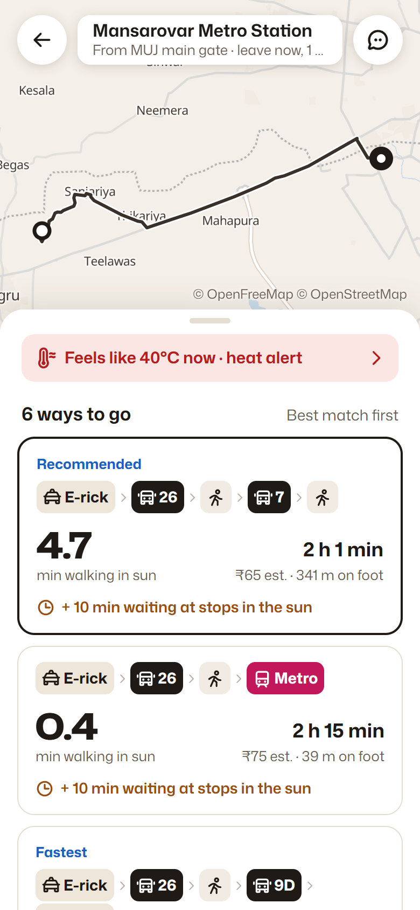
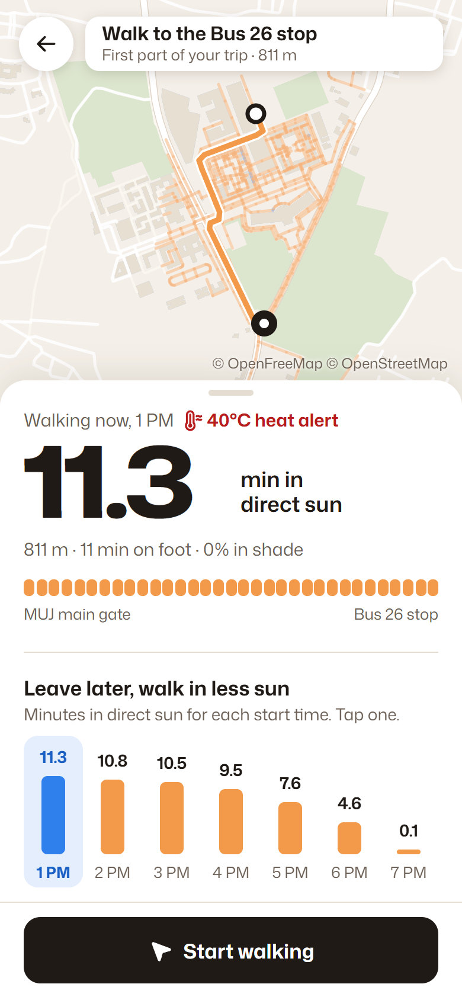
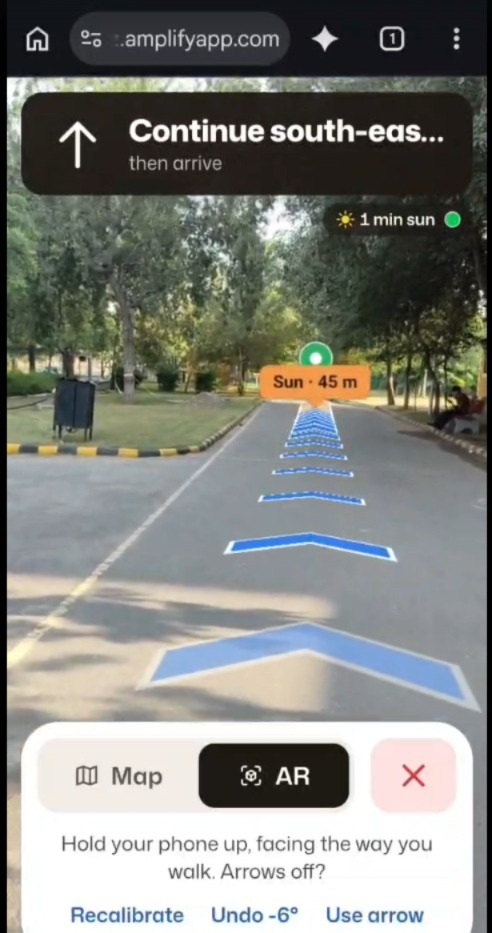
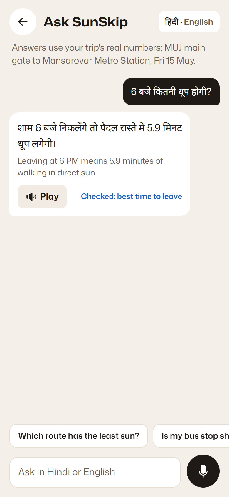
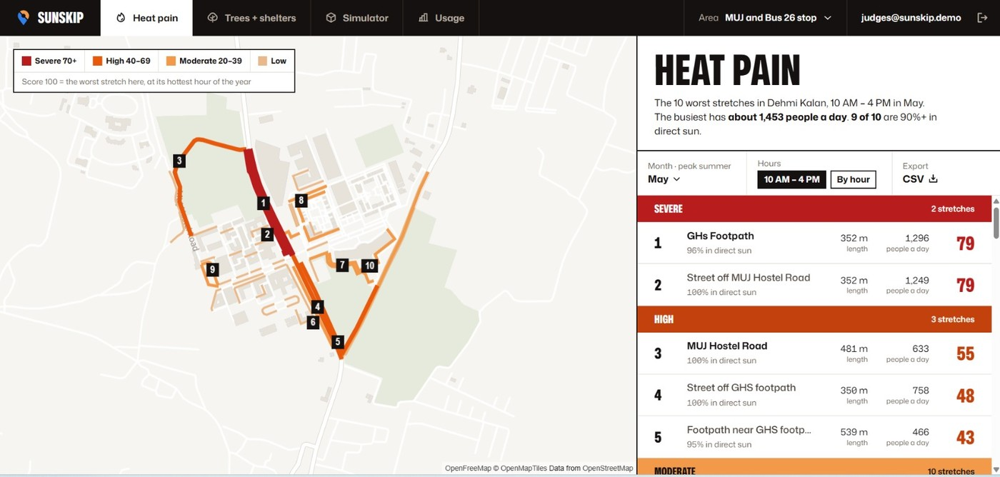
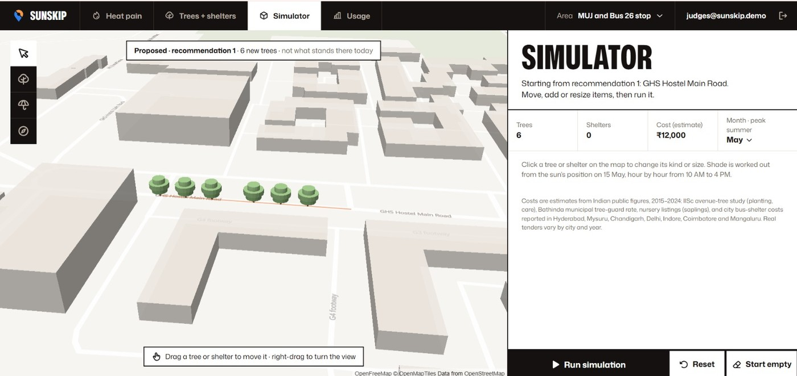
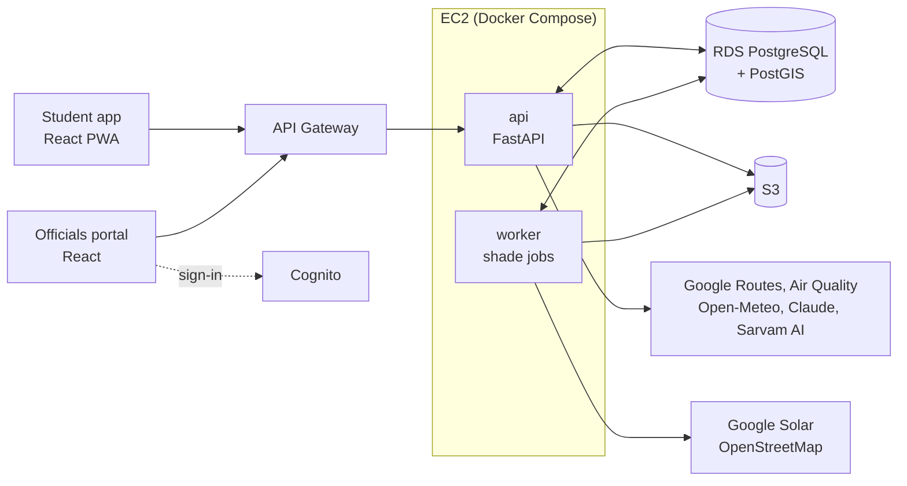

<div align="center">


### Skip the sun, not the trip.

<br>


**[Student app](https://main.d2p3yf0fdqcxbz.amplifyapp.com)** · **[Officials portal](https://main.d2amqkpwwnkri3.amplifyapp.com)** · **[How it works](#how-it-works)** · **[Run locally](#run-locally)**

</div>

<br>

SunSkip finds the route with the **least time in direct sun**. Ask it how to get from the main gate of Manipal University Jaipur to the Bus 26 stop, and it compares every way there on foot, by bus, metro or e-rickshaw, works out how many minutes of each walk are in the sun, and tells you the best hour to leave. An officials portal turns the same data into decisions: which footpaths leave the most people exposed, and where a tree or shelter would save the most sun minutes per rupee.

<p align="center">
  
  
  
  
  
</p>

## Why

At midday in May the sun over Jaipur stands at about 82°, so a 10 m building casts a shadow only 1.4 m long. Buildings give almost no relief; only trees, shelters and timing do. Navigation apps optimise for distance and time and have no idea where the shade is, and city planners have no data on where shade is missing or who it would help.

The pilot walk, 810 m from the MUJ main gate to the Bus 26 stop on 15 May:

| Leave at | 7 AM | 10 AM | 1 PM | 4 PM | 5 PM | 6 PM |
| --- | --- | --- | --- | --- | --- | --- |
| Minutes in sun | 5.6 | 11.3 | **11.3** | 9.5 | 7.6 | 4.6 |

At 1 PM the whole walk is in the sun. Leaving at 6 PM cuts it to 4.6 minutes.

## Features

### Student app

<table>
  <tr>
    <td width="50%" valign="top">
      
      <h3>Routes ranked by sun, not just time</h3>
      Every option across walking, bus, metro and e-rickshaw shows its minutes in direct sun next to total time, fare and distance on foot. Ranking uses heat dose: sun minutes weighted by how hot each hour feels.
    </td>
    <td width="50%" valign="top">
      
      <h3>The best time to leave</h3>
      Hour bars from 7 AM to 7 PM show how the same walk changes through the day, with a sun and shade strip for the hour you pick.
    </td>
  </tr>
  <tr>
    <td width="50%" valign="top">
      
      <h3>Navigation and an AR view</h3>
      Turn-by-turn directions with rerouting, spoken in Hindi. Point the camera at the road and arrows appear on the path: blue in shade, orange in sun.
    </td>
    <td width="50%" valign="top">
      
      <h3>Ask SunSkip, in your language</h3>
      Ask about a trip by text or voice in English, Hindi or Hinglish. Claude answers from the real route data, and Sarvam AI handles speech.
    </td>
  </tr>
</table>

Also: a shade map for any hour, feels-like temperature, air quality, a heat alert at 40 °C, and install to the home screen as a PWA.

### Officials portal

<table>
  <tr>
    <td width="50%" valign="top">
      
      <h3>Heat pain</h3>
      Ranks footpath stretches by how many people walk them and how much of each is in the sun.
    </td>
    <td width="50%" valign="top">
      
      <h3>Simulator</h3>
      Place trees and shelters on a 3D map and compare shade before and after, with estimated cost. Recommendations are ranked by sun minutes saved per rupee.
    </td>
  </tr>
</table>

The **Usage** screen shows trips planned, routes chosen and where trips start. A demo account is on the [sign-in page](https://main.d2amqkpwwnkri3.amplifyapp.com).

## How it works



1. **Shade data.** Google's Solar API provides hourly shade rasters. SunSkip splits the map into small cells and stores twelve monthly shade files per cell in S3.
2. **Scoring.** For each walk Google Routes returns, shade is sampled every 5 m while the clock advances at walking speed, so the score reflects where the sun will be when you actually get there. Routes are ranked by heat dose, time and fare.
3. **Never wait.** A request for a new area returns plain routes straight away while a background worker fetches shade. The app polls and re-ranks once the data is ready. Where Google has no coverage, sun minutes show as "unknown" rather than a guess.
4. **Planning.** A nightly job estimates foot traffic on each path from a simple transport model plus the routes people choose in the app. The simulator casts shadows from proposed trees and shelters with pvlib sun positions to measure the minutes saved.

## Tech stack

| Layer | Tools |
| --- | --- |
| Front ends | React 19, React Router 7, TypeScript, Vite, Tailwind CSS 4, MapLibre GL, Phosphor icons, vite-plugin-pwa |
| AR | three.js, LocAR |
| Backend | Python 3.12, FastAPI, Pydantic, asyncpg, httpx |
| Geo and solar | PostgreSQL 16 + PostGIS, Shapely, pyproj, rasterio, NetworkX, pvlib |
| AI and voice | Claude (trip assistant), Sarvam AI (speech-to-text, translation, text-to-speech) |
| Data sources | Google Solar, Routes and Air Quality APIs, Open-Meteo, OpenStreetMap (Overpass) |
| AWS | EC2 (Docker Compose), RDS, S3, API Gateway, Cognito, Amplify, Secrets Manager |
| CI | GitHub Actions: ruff on the API, type-checked builds of both front ends |

## Run locally

**You need:** Git, Python 3.12, Node 22 and Docker. Both front ends run on built-in mock data by default, so you can try them without the API or any keys.

**1. API.**

```bash
cd api
python3.12 -m venv .venv && source .venv/bin/activate   # PowerShell: py -3.12 -m venv .venv; .\.venv\Scripts\Activate.ps1
pip install -r requirements.txt
cp .env.example .env
docker compose -f docker-compose.dev.yml up -d --wait   # PostGIS on port 5433
python -m scripts.migrate                               # create tables
uvicorn app.main:app --reload                           # http://127.0.0.1:8000/docs
```

| Variable | What it is |
| --- | --- |
| `DATABASE_URL` | Postgres connection string (the dev container by default) |
| `USE_FAKES` | `true` returns fixed responses for the pilot walk, no keys needed |
| `GOOGLE_API_KEY` | Solar, Routes and Air Quality APIs |
| `ANTHROPIC_API_KEY` | Claude, for Ask SunSkip |
| `SARVAM_API_KEY` | Sarvam AI, for voice |
| `AGENT_LIVE`, `VOICE_LIVE` | Turn on the live assistant and voice endpoints |
| `S3_BUCKET`, `AWS_REGION`, `SECRET_ID` | Shade file storage and Secrets Manager (production) |

For real data, set `GOOGLE_API_KEY` and `USE_FAKES=false`, run `python -m app.worker` in a second terminal, then `python -m scripts.preload --area muj`.

**2. Student app.**

```bash
cd app
npm install
cp .env.example .env
npm run dev          # https://localhost:5173 (accept the self-signed certificate)
```

The dev server uses HTTPS because phones only share the camera, GPS and compass with secure pages.

**3. Officials portal.**

```bash
cd portal
npm install
cp .env.example .env
npm run dev          # http://localhost:5174
```

| Variable (both front ends) | What it is |
| --- | --- |
| `VITE_USE_MOCKS` | `true` answers every call from `src/api/fixtures/`; `false` uses the API |
| `VITE_API_BASE_URL` | `/v1` locally (the dev server forwards it), the full API URL in production |
| `API_PROXY_TARGET` | Where the dev server forwards `/v1`. Defaults to `http://localhost:8000` |
| `VITE_MAP_STYLE_URL` | Map style (OpenFreeMap Positron) |
| `VITE_COGNITO_DOMAIN`, `VITE_COGNITO_CLIENT_ID` | Portal only. Leave the client ID empty to skip sign-in |
| `VITE_DEMO_NOW` | App only, optional. The time treated as "now", e.g. `2026-05-15T13:00:00+05:30` |

**Before pushing**, run the same checks as CI:

```bash
(cd api && ruff check . && ruff format --check .)
(cd app && npm run build)
(cd portal && npm run build)
```

## Project structure

```
api/
  app/
    routes/             trip planning: Google legs, e-rickshaw, exposure, ranking, best time
    shade/              shade tiles, segments, and the job queue
    worker/             background jobs: Google Solar, OSM, scoring, foot-traffic demand
    portal/             heat-pain reports, recommendations, the shade simulator
    agent/  voice/      Ask SunSkip (Claude) and speech (Sarvam AI)
    conditions/         weather and air quality
    core/               sun position, geo helpers, caps, middleware
    db/                 PostGIS queries
  migrations/           SQL schema
  scripts/              migrate, preload an area, seed zones
app/                    student PWA
  src/
    pages/              home, search, results, walk detail, best time, shade map, navigation
    features/           ar, voice, agent
    components/  api/   UI pieces and the API client with fixtures
portal/                 officials portal
  src/
    pages/              sign-in, heat pain, recommendations, simulator, usage
    components/  api/
```

## License

Copyright © 2026 the SunSkip team. All rights reserved. The source is public to read; it is not licensed for reuse.
