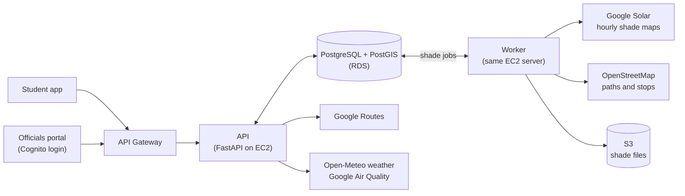

# SunSkip

SunSkip finds walking and bus routes with the least direct sun, anywhere in India.

- **Students** enter where they are going. SunSkip shows each route with the minutes they will spend in the sun, and the best time to leave.
- **City officials** see which footpaths are the hottest for the most people, and where trees or shelters would help most.

For example, the 810 m walk from Manipal University Jaipur to the Bus 26 stop is in direct sun for 11.3 minutes at 1 PM and 7.4 minutes at 5 PM in May.

## How it works



1. The app asks the **API** for routes. The API gets the routes from Google Routes and the weather from Open-Meteo.
2. The API checks the sun along every walking part of each route, hour by hour, using Google Solar's shade maps.
3. If an area has no shade data yet, the API answers straight away and adds a **shade job** to the database. The **worker** downloads the shade maps and the footpaths for that area, and the next request gets full results.
4. The portal uses the same data to rank footpaths by how much sun people walk through, and to test where new trees or shelters would help.

Built with Python 3.12, FastAPI, PostgreSQL 16 with PostGIS, and Docker, running on AWS. More detail: [product](docs/PRD.md), [tech](docs/TRD.md), [API](docs/api.md), [database](docs/schema.md), [team rules](CLAUDE.md).

## Set it up on your laptop

You need **Git**, **Python 3.12** and **Docker Desktop** (open Docker Desktop before you start). The commands are for Windows PowerShell; the Mac/Linux version is given where it differs.

**1. Get the code** (the repo is private: ask Suryansh to add your GitHub account)

```powershell
git clone https://github.com/suryansh04/sunskip.git
cd sunskip/api
```

**2. Install** (takes about 4 minutes)

```powershell
py -3.12 -m venv .venv
.\.venv\Scripts\Activate.ps1
pip install -r requirements.txt
```

- Mac/Linux: `python3.12 -m venv .venv` then `source .venv/bin/activate`.
- If Windows says running scripts is disabled, run `Set-ExecutionPolicy -Scope CurrentUser RemoteSigned` once, then try again.
- In every new terminal, go to the `api` folder and run the activate line again before the commands below.

**3. Create your settings file**

```powershell
copy .env.example .env
```

Mac/Linux: `cp .env.example .env`.

**4. Start the database**

```powershell
docker compose -f docker-compose.dev.yml up -d
```

Wait about 10 seconds, then create the tables:

```powershell
python -m scripts.migrate
```

It prints `applied 0001_init.sql`.

**5. Run it with sample data** (no Google key needed)

In `.env`, set `USE_FAKES=true`. Then start the API:

```powershell
uvicorn app.main:app --reload
```

Open a second terminal and ask for a route (Manipal University Jaipur to the Bus 26 stop, 1 PM on 15 May):

```powershell
$body = '{"origin": {"lat": 26.84406, "lng": 75.56516}, "destination": {"lat": 26.83894, "lng": 75.56537}, "departAt": "2026-05-15T13:00:00+05:30"}'
$plan = Invoke-RestMethod http://127.0.0.1:8000/v1/routes/plan -Method Post -Headers @{"X-Client-Id" = "me"} -ContentType "application/json" -Body $body
$plan.options | Select-Object @{n = "route"; e = { $_.legs.mode -join " + " } }, @{n = "sunMinutes"; e = { $_.exposure.sunMinutes } }
```

Mac/Linux:

```bash
curl -X POST http://127.0.0.1:8000/v1/routes/plan -H "X-Client-Id: me" -H "Content-Type: application/json" \
  -d '{"origin": {"lat": 26.84406, "lng": 75.56516}, "destination": {"lat": 26.83894, "lng": 75.56537}, "departAt": "2026-05-15T13:00:00+05:30"}'
```

You should see a `WALK` route with `11.3` sun minutes. This mode is enough for building the app and the portal. All endpoints are listed at http://127.0.0.1:8000/docs.

**6. Run it with real data** (needs a Google API key with the Routes, Solar and Air Quality APIs turned on)

Stop the API (Ctrl+C). In `.env`, set `GOOGLE_API_KEY=your-key` and `USE_FAKES=false`. Then use three terminals, each with the virtual environment activated:

```powershell
# terminal 1: the API
uvicorn app.main:app --reload

# terminal 2: the worker
python -m app.worker

# terminal 3: load the Manipal University Jaipur area (about 4 minutes)
python -m scripts.preload --area muj
```

When terminal 2 prints `Job ... done`, run these in terminal 3:

```powershell
python -m scripts.seed_zones
python -m app.worker.demand
```

Ask for the same route as in step 5. You should again see `WALK` with `11.3` sun minutes, now worked out from real shade data, plus an `ERICKSHAW` option.

**Before you push**

```powershell
ruff check .
ruff format --check .
```

Both must pass. GitHub runs them on every push.
