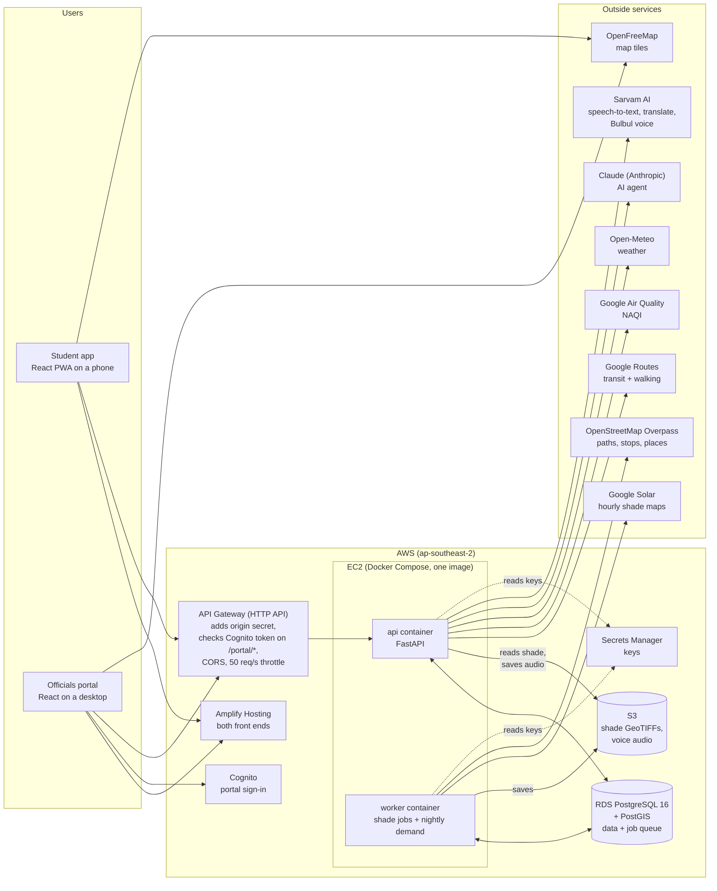
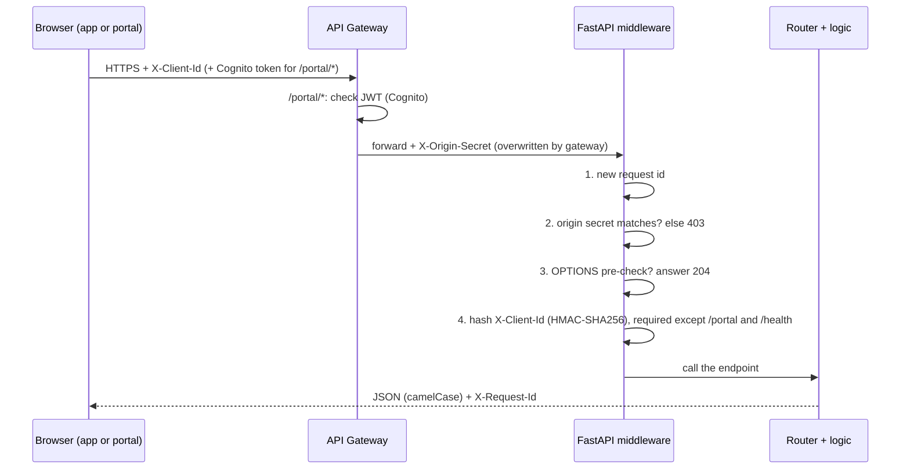
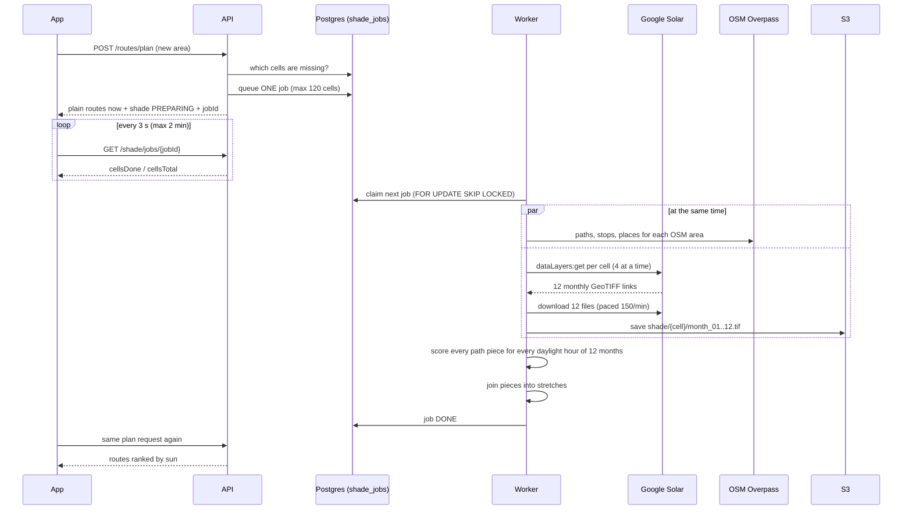
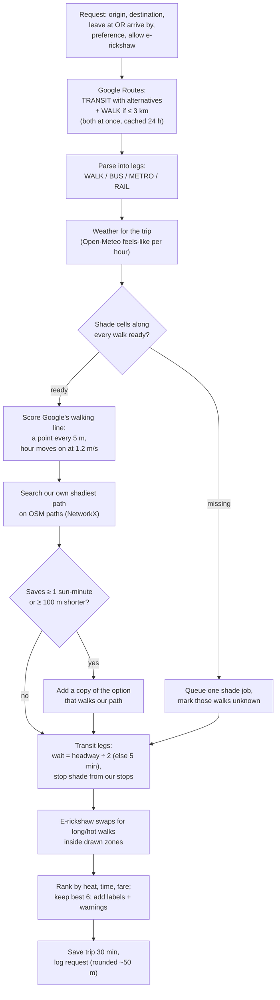
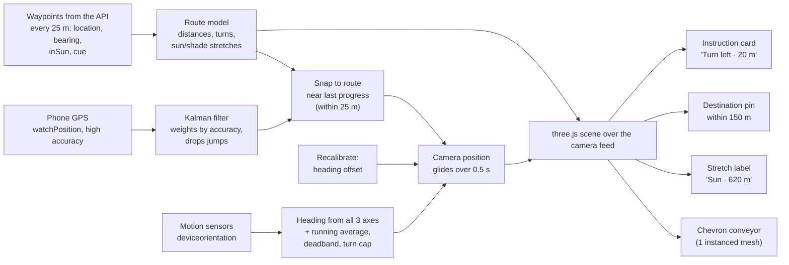
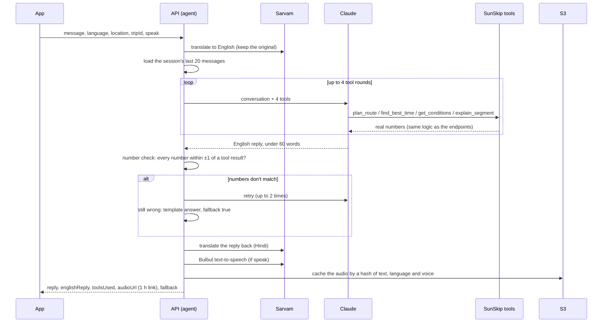
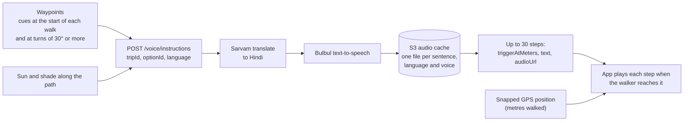
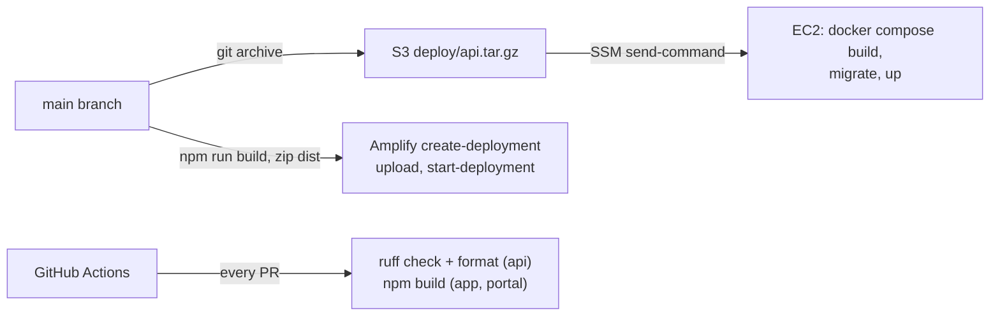

# SunSkip: everything for the presentation

> **Skip the sun, not the trip.**
>
> SunSkip finds the walking, bus, metro and e-rickshaw route with the **fewest minutes in direct sun**, anywhere in India, and tells you the **best time to leave**. Students can **ask it questions by voice in Hindi or English** and get **spoken directions in Hindi** while they walk. A second product, the **officials portal**, shows city teams **which footpaths hurt the most people** and **where trees or shelters would help most**, with costs and a 3D what-if simulator.
>
> Written from the code and the API design in `docs/api.md` (11 Oct 2026). Every number here comes from the code, the live API or our pilot data. Where something is an estimate, it says so.

---

## Contents

1. [The problem](#1-the-problem)
2. [What we built](#2-what-we-built)
3. [Live links](#3-live-links)
4. [Architecture](#4-architecture)
5. [Tech stack](#5-tech-stack)
6. [How shade data works](#6-how-shade-data-works-the-core-idea)
7. [How a route is planned](#7-how-a-route-is-planned)
8. [Student app: every feature](#8-student-app-every-feature)
9. [AR walking view: how it works](#9-ar-walking-view-how-it-works)
10. [AI agent and voice navigation](#10-ai-agent-and-voice-navigation)
11. [Officials portal: every feature](#11-officials-portal-every-feature)
12. [Formulas](#12-formulas)
13. [API: all 19 endpoints](#13-api-all-19-endpoints)
14. [Database](#14-database)
15. [Background worker](#15-background-worker)
16. [Cost control](#16-cost-control)
17. [Privacy and security](#17-privacy-and-security)
18. [AWS deployment](#18-aws-deployment)
19. [Real numbers for the slides](#19-real-numbers-for-the-slides)
20. [What makes SunSkip different](#20-what-makes-sunskip-different)
21. [Honest limits and what's next](#21-honest-limits-and-whats-next)
22. [Team and build](#22-team-and-build)
23. [Suggested slide outline](#23-suggested-slide-outline)

---

## 1. The problem

- In Indian summers, the **walk to and from the bus or metro** is the part of a trip spent in full sun. Jaipur's average May daily high is **40.5 °C** (IMD).
- At midday in May the sun is almost straight overhead (**82°** at MUJ on 15 May, 12:24 IST). A 10 m building then throws a shadow of only **1.4 m**. **Buildings give almost no shade; only trees, shelters and timing help.**
- **Google Maps shows the shortest walk, not the coolest.** It has no idea of sun or shade.
- **City officials have no data** on where shade is missing, how many people walk there, or what a tree or shelter would change.
- Hot walks and hot waits at unshaded stops **push people away from public transport**.

**Our proof, from a real walk at Manipal University Jaipur (MUJ):**

- The walk: **810 m** from the MUJ main gate to the **Bus 26 stop** (the main bus off campus).
- At **1 PM in May** it is **11.3 minutes in direct sun** (0% shade). At **5 PM** it is **7.6 minutes** (the API's number; our pilot data file said 7.4).
- About **635 m** of the walk is in sun every hour from 9 AM to 4 PM.
- The worst stretch is **~430 m with no shade at all**, on the GHS footpath: exactly the kind of stretch the portal flags for trees.

Hackathon themes it hits: **Heat** (cuts heat exposure on real walks), **Public transport** (fixes the hot walk and the hot wait), **Air** (the heat details show India's air quality index, NAQI).

---

## 2. What we built

Three parts in one repository:

| Part | Who uses it | What it does |
| --- | --- | --- |
| **Student app** (`app/`) | Anyone walking to transit in India (pilot: MUJ students) | Plans trips ranked by sun, shows the best time to leave, a shade map, turn-by-turn walking with a live map, **AR arrows through the camera**, a compass arrow backup, an **AI assistant (text and voice, Hindi/English)** and **spoken Hindi directions** |
| **Officials portal** (`portal/`) | City officials, campus and transit teams | Heat-pain map of the worst footpaths, tree and shelter recommendations with costs, one-page evidence for a proposal, a **3D what-if simulator**, usage stats |
| **Backend** (`api/`) | Both front ends | FastAPI server + a background worker that fetches Google's hourly shade maps and OpenStreetMap paths on demand, scores every path for every month and hour, and plans routes |

The app is the **daily product**. Every trip people plan feeds **demand data** into the portal. The portal is the **impact story**: it turns the same data into planting and building decisions.

---

## 3. Live links

| What | URL |
| --- | --- |
| Student app (installable PWA, open on a phone) | https://main.d2p3yf0fdqcxbz.amplifyapp.com |
| Officials portal (desktop) | https://main.d2amqkpwwnkri3.amplifyapp.com |
| API | https://7mhceh7sl0.execute-api.ap-southeast-2.amazonaws.com/v1 |
| API health | https://7mhceh7sl0.execute-api.ap-southeast-2.amazonaws.com/v1/health |
| Clickable design prototype | https://sunskip-ui.vercel.app |

The portal's sign-in page has a **"Sign in as demo user"** button for judges (one click, no typing). The other button signs in with a city account through Amazon Cognito.

---

## 4. Architecture

### 4.1 The whole system



**Key design choices:**

- **The api and the worker never call each other.** They talk only through the `shade_jobs` table in Postgres (a job queue using `FOR UPDATE SKIP LOCKED`).
- **A request never waits for shade data.** If an area isn't ready, the API answers straight away with plain routes and `shade.status: "PREPARING"` plus a job id. The app polls the job and re-plans by itself when it's done.
- **Shade is fetched once per map cell, ever.** After that, every trip through that area is instant and free.
- **Every request finishes in under 29 s** (API Gateway's hard limit). The plan endpoint targets 3 s.

### 4.2 Request path and security layers



### 4.3 Code layout

```
sunskip_app/
├── api/                    FastAPI + worker (Python 3.12)
│   ├── app/
│   │   ├── main.py             creates the app, middleware, 8 routers under /v1
│   │   ├── config.py           every tunable number + secrets (Secrets Manager in production)
│   │   ├── core/               errors, middleware, shared HTTP client, formulas, geo maths, sun position, storage
│   │   ├── contracts/          Pydantic models (camelCase JSON), public ids, fake answers
│   │   ├── db/                 connection pool, plain-SQL query files, cleanup loop
│   │   ├── meta/ health/       settings and health check
│   │   ├── conditions/         weather (Open-Meteo) + air quality (Google)
│   │   ├── shade/              shade map, job queue, reading GeoTIFFs
│   │   ├── routes/             trip planning, shadiest path, ranking, e-rickshaw, best time, waypoints, place search
│   │   ├── portal/             heat pain, recommendations, simulator, stretch evidence, labels
│   │   ├── agent/              AI agent: Claude with 4 tools, number check, sessions
│   │   ├── voice/              Sarvam speech-to-text, translation, Bulbul voice, S3 audio cache
│   │   └── worker/             job loop, Overpass, Solar, scoring, stretches, nightly demand
│   ├── migrations/0001_init.sql
│   └── scripts/                migrate, preload demo areas, seed e-rickshaw zones
├── app/                    student app (React PWA)
│   └── src/  pages/ components/ api/ features/ar/ features/agent/ features/voice/
├── portal/                 officials portal (React, desktop)
│   └── src/  pages/ components/ api/ auth.ts costs.ts shapes.ts ...
├── docs/                   PRD, TRD, api, schema, design, plans
└── .github/workflows/ci.yml   ruff for api, npm build for app and portal
```

---

## 5. Tech stack

### Front ends (app and portal)

| Use | Package |
| --- | --- |
| Build tool | Vite 7 + @vitejs/plugin-react 5 |
| UI | React 19 |
| Language | TypeScript 5.9 (`.tsx`, `strict: false`) |
| Styling | Tailwind CSS 4 |
| Pages | React Router 7 |
| HTTP | axios 1 (one shared client) |
| Maps | MapLibre GL 5 (used directly, no wrapper) with OpenFreeMap "Positron" tiles, recoloured |
| Icons | Phosphor Icons 2 (Bold weight) |
| Font | Mona Sans (Google Fonts); the app adds Noto Sans Devanagari for Hindi |
| Installable app (app only) | vite-plugin-pwa 1 (service worker + manifest) |
| AR (app only) | **three.js 0.181** + **LocAR 0.2.12** (location-based AR) |
| Phone testing | @vitejs/plugin-basic-ssl (HTTPS so phones share camera, GPS and compass) |

**Deliberately not used:** Redux/Zustand/Context, TanStack Query, UI kits, chart libraries (bars are plain `div`s, grids are CSS grid), react-map-gl, deck.gl. Only `useState`, `useEffect`, `useRef`.

### Backend

| Use | Package |
| --- | --- |
| API | FastAPI, uvicorn, Pydantic v2, pydantic-settings |
| Database | asyncpg with plain SQL (no ORM), PostgreSQL 16 + PostGIS |
| Geo + maths | NetworkX (path search), NumPy, rasterio (GeoTIFFs), Shapely (shadow shapes), pyproj, **pvlib** (sun position) |
| Outside calls | httpx (one shared async client, 10 s timeout), boto3 (S3, Secrets Manager) |
| AI / voice | anthropic (Claude Messages API with tools), sarvamai (speech-to-text, translate, Bulbul TTS) |
| Lint | ruff (also checks type hints) |
| Runtime | Python 3.12, Docker, Docker Compose |

### Cloud and services

| Service | Used for |
| --- | --- |
| **AWS EC2** (c7i-flex.large, Ubuntu 24.04) | Runs the api and worker containers |
| **AWS RDS** (PostgreSQL 16, db.t4g.micro) | All data + the job queue |
| **AWS S3** | Shade GeoTIFFs (12 per map cell) and cached voice audio |
| **AWS API Gateway** (HTTP API) | Public HTTPS entry, Cognito JWT check, CORS, throttle |
| **AWS Cognito** | Portal sign-in (code + PKCE, refresh tokens, demo account) |
| **AWS Amplify Hosting** | Hosts both front ends |
| **AWS Secrets Manager** | Google, Anthropic and Sarvam keys, database URL, origin secret, hashing salt |
| **AWS IAM + Systems Manager** | Server role (no SSH keys, port 22 closed); deploys run through SSM |
| Google Routes API | Transit and walking routes, transit fares |
| Google Solar API | Hourly shade maps (1 m per pixel) |
| Google Air Quality API | NAQI (India's air quality index, CPCB scale) |
| Open-Meteo | Temperature and feels-like, forecast + archive |
| OpenStreetMap (Overpass) | Footpaths, roads, bus and metro stops, hostels, colleges, gates, shops |
| OpenFreeMap | Free map tiles, no key |
| **Claude** (Anthropic) | The AI agent: answers questions using SunSkip's own tools |
| **Sarvam AI** | Hindi/English speech-to-text, translation, and the Bulbul text-to-speech voice |
| GitHub Actions | CI on every pull request |

---

## 6. How shade data works (the core idea)

Google's **Solar API** was built for rooftop solar panels. One of its layers is an **hourly shade map**: for each 1 m pixel, for every hour of every day of a month, whether that spot is in sun. We repurposed it for **people walking on the ground**.

### 6.1 Cutting India into cells

- The map is cut into **geohash-7 cells** (about **150 × 140 m** in Jaipur).
- OpenStreetMap data is fetched by bigger **geohash-6 areas** (about 1.1 × 0.6 km).
- For a route, the API buffers the walking line by **100 m** and lists every cell it touches.

### 6.2 On-demand fetch



### 6.3 Reading the shade files

- Each cell has **12 GeoTIFFs** (one per month), each with **24 bands** (one per IST hour).
- Each pixel is a 32-bit number; **bit (day − 1) set means SUN** that day. We use **day 15** of each month as the representative day.
- The reader opens a file once, decodes all 24 hours at once, and keeps up to **128 decoded tiles** in memory (about 5 MB each).
- Every answer is **sun (1), shade (0) or no data (−1)**. **No data is never counted as shade.** We never claim shade we can't see.

### 6.4 Scoring the paths

- OpenStreetMap ways (footways, paths, steps, residential, service roads and more; private ways excluded) are cut at every node, then into pieces of **at most 50 m** (`segments`).
- Each piece is sampled **every 5 m**. For every month and every hour when the sun is at least **5° up** (from pvlib), we store its **sun fraction** (share of points in sun) and **no-data fraction**.
- Bus and metro stops get a **3 × 3 grid of points 2.5 m apart**; a stop counts as **shaded** when less than half of it is in sun.
- Neighbouring pieces are joined into **stretches** (what officials see): two pieces join at a node shared only by them when their sun differs by less than **0.2**. The stretch gets the most common OSM name.

---

## 7. How a route is planned

`POST /routes/plan` is the core endpoint. Target: **3 seconds**.



**Details that matter:**

- **Past times:** Google can't plan transit in the past, so the API asks for the same weekday and time in a future week, then shifts the times back.
- **Arrive by:** asks Google for transit arriving by then, leaves as early as the longest option needs, then re-checks the trips it would really plan and leaves earlier (up to twice) by however late the latest one is.
- **Shadiest path:** a graph of shade-ready OSM pieces within 100 m of Google's line. Edge cost = `length × (1 + 3.0 × sun fraction × heat weight)`. It is used only if it is at most **1.3×** the shortest path. Many campus and colony footpaths exist in OSM but not in Google, so "**clearly shorter**" also counts.
- **E-rickshaw:** a walk over **500 m** or with over **5 hot-sun minutes**, with both ends inside one zone (MUJ 3 km circle, 1.5 km around each Jaipur metro station). Time = distance ÷ 4.2 m/s + 2 min wait. Fare = ₹10 + ₹10 per km, **always labelled an estimate**.
- **Labels:** RECOMMENDED (lowest score), FASTEST, CHEAPEST, COOLEST (lowest heat dose). Labels are added after the cut to 6, so each points at a visible option.
- **Warnings:** HEAT_ALERT (feels-like ≥ 40 °C), LONG_WAIT_IN_SUN (≥ 5 min), SHADE_PREPARING, NO_SHADE_DATA, NO_SHADE_DATA_PARTIAL, FARE_ESTIMATED.
- **While shade is preparing,** options are ranked by time and fare only and none is called COOLEST. Once shade is in, the same request comes back ranked by heat.
- **Google outage:** if transit fails but a short walk-only route exists, the plan still answers.

---

## 8. Student app: every feature

Phone-first (360 px wide), installable as a PWA. Each screen has loading, error and empty states. Unknown numbers show as **"unknown"**, never 0. The app never says "safe".

### 8.1 Home (`/`)
- **Map around you**, with nearby streets coloured for the current hour (**orange** when at least half is in sun, **blue** when shaded, grey when unknown), and "**X% of streets near you in sun**".
- **Location:** a GPS filter keeps listening until the fix is within **10 m** or 20 s pass (the first fix is often a rough Wi-Fi guess). If no location comes, it starts from the MUJ main gate and says so.
- **Heat chip:** "Feels like 41°C"; it **turns red with "heat alert"** at feels-like ≥ 40 °C. Tap it for the **heat sheet**: feels-like bars for 7 AM to 7 PM and the **NAQI air quality**.
- **"Where to?"** search, the start line, and **Leave now / Leave at / Arrive by**. The time sheet shows **each hour's minutes in sun** for the trip, so you can pick a cooler time.
- **Recent places** (last 3), and a link to the shade map.
- Streets still being prepared fill in by themselves when their shade job finishes.

### 8.2 Search (`/search`)
- Searches **real named places near you from OpenStreetMap** (hostels, colleges, campus gates, food, shops, bus stops, metro stations) through `GET /places`, nearest first.
- **Student nicknames:** "GHS" or "girls hostel" finds the girls' blocks (G1, G3…), "BHS" or "boys hostel" the boys' blocks.
- Built-in demo places (Mansarovar Metro, Bus 26 stop, Civil Lines, Sindhi Camp, Chandpole).
- Anything typed can be **looked up by name** (Google), or **picked on the map** with a pin.
- **Change the start:** pick it on the map, or **"Use my current location"**, which follows the GPS on the map with a live **±metres** reading and warns if the phone only shares an approximate location.

### 8.3 Route options (`/results`)
- One **card per option**: labels, the chain of modes (walk → bus → walk), **minutes walking in sun** (big number), total time, fare, metres on foot, and **minutes waiting in sun** at the stop.
- The map shows the chosen option, with walking parts coloured by sun.
- **"Preparing shade data… 6 of 14 map areas ready"** with a progress bar while a new area loads; the list **re-ranks by itself** when the data is in (polls every 3 s, gives up after 2 min).
- Clear notices when there is **no shade data** (outside India, Google has none, or budget used).
- States for no route, offline, and other errors.

### 8.4 Option detail (`/results/:optionId`)
- The option's minutes in sun, time, fare, metres on foot.
- **Legs timeline:** wait (and whether the stop has shade), each walk with its own sun/shade strip, bus line and stop, metro line, e-rickshaw with estimated fare, arrival.
- **"Take this route"** records the choice (`POST /routes/{tripId}/choice`, the portal's demand signal) and opens navigation.

### 8.5 Walk detail (`/walk`)
- One walk: big **minutes in direct sun**, metres, % in shade, and a **sun strip** of the whole walk.
- The line **draws itself** on the map; choosing another hour **recolours it piece by piece**.
- **"Leave later, walk in less sun":** hour bars; tapping one shows the sun for leaving then (no new plan needed, the waypoints are re-read for that time).
- **"Or skip the sun":** an **e-rickshaw** alternative (time, estimated fare) and a **shadier path** if one exists.
- **"Start walking at 5 PM"** opens navigation with the sun shown for that time.

### 8.6 Best time to leave (`/best-time`)
- One bar per hour from 7 AM to 7 PM: minutes in direct sun on the walking parts. The **best hour** is highlighted with the next two best.
- Where there's no shade data, it compares hours by **sun angle and temperature** and shows an **"estimate"** badge.
- Tap an hour to plan for it.

### 8.7 Shade map (`/map`)
- Streets around a point coloured for any hour, with an **hour slider (7 AM – 7 PM)**, "% of streets here in sun" and a legend (sun, shade, no data).
- If a walk is open, it is drawn too, with its minutes in sun at that hour.
- Moving the map loads the new area (max 1 km²); new areas are prepared on demand.

### 8.8 Navigate (`/trip/:tripId/:optionId`)
Three views over the same waypoints: **Map**, **AR**, **Arrow**.

- **Map view:** tilted 3D camera (pitch 52°) that follows you and turns with your walking direction. Shows the next instruction, **sun minutes left**, **minutes to go**, **arrival time**, and your place on the sun strip.
- **Live GPS:** a Kalman-style filter smooths the fixes, drops jumps (reflections off buildings), and **snaps you onto the path** within 25 m. Notes say when GPS is weak (±30 m+) or you're off the path.
- **Rerouting like a sat-nav:** off the path by more than **30 m for 8 s** (with a trustworthy fix, more than 50 m from the end) → plans a new walk from where you are, at most once every 20 s.
- **Multi-walk trips:** "Next walk of this trip" moves to the next walking leg.
- **Routes with no walking** (e-rickshaw or rides only) show a ride guide instead.
- **Spoken directions in Hindi:** each step plays when you reach it, with a caption on screen and a mute button (see §10.3).
- **Arrow backup:** one big arrow, **blue in shade, orange in sun**, turned by the phone's compass (works on Android and iPhone), with distance and the next instruction. Used when the camera isn't available or the walker prefers it.

### 8.9 Ask SunSkip
- Ask anything about your trip **by text or voice, in Hindi, English or Hinglish**, and hear the answer. Full details in §10.

### 8.10 Other app details
- **Installable PWA** with icons; the logo is a **map pin split into a sun-orange half and a shade-blue half**.
- **Mock mode** (`VITE_USE_MOCKS=true`) runs the whole app on saved real responses, without the API.
- Anonymous **client id** (random UUID in the browser); the server stores only its hash.

---

## 9. AR walking view: how it works

AR is a **must-have** feature: arrows painted **on the real path through the camera**, **blue where the path is shaded, orange where it's in sun, grey where unknown**. It is built with **three.js + LocAR** and loads only when opened (the 3D libraries are a separate download).

### 9.1 Pipeline



### 9.2 What the walker sees
- **Chevron conveyor:** flat chevrons **flowing forward along the path** from 3 m to 60 m ahead, spaced 2.75 m, moving at 1.5 m/s. Each takes the colour of the path piece it sits on. They lie flat near you and **lean up further away** (up to 32°) so far ones don't become a thin line; the nearest are drawn a bit bigger and far ones grow so they stay visible; they **fade in and out** so nothing pops. All drawn as **one instanced mesh** (one draw call), so it runs smoothly on phones.
- Chevrons are anchored **to the ground**, not the walker: a GPS update doesn't make them jump; progress **glides** to the new position.
- **Stretch label:** a floating pill at the start of the next stretch: "**Sun · 620 m**", "**Shade · 120 m**" or "No shade data".
- **Destination pin:** a green pin appears when you are within **150 m** of the end.
- **Instruction card:** "Continue north · 120 m, then turn right", "Turn left · 20 m" (within 25 m of a turn), "You have arrived" (within 8 m), plus **minutes of sun ahead** and a **GPS quality dot** (good ≤ 8 m, fair ≤ 15 m, poor).
- **Vibration** when passing a turn (Android).

### 9.3 Accuracy fixes (what makes it work outdoors)
- **Our own GPS watch** instead of LocAR's (LocAR would move the camera on every raw fix). The filter weights each fix by its reported accuracy, rejects jumps beyond 3 sigma (accepted after 3 in a row, e.g. after a tunnel), and ignores tower/Wi-Fi fixes worse than 100 m once a better one has come.
- **Snapping** searches near the last progress first (30 m back, 80 m ahead), so a path that doubles back doesn't jump ahead.
- **Heading from all three sensor axes**, so tilting or rolling the phone doesn't swing the arrows; lying nearly flat, the top edge takes over smoothly. A running average, a **2.5° deadband** and a **180°/s turn cap** stop compass glitches.
- **Recalibrate:** point the phone along the path and tap; the compass error is corrected. Offsets over 45° ask "Are you pointing along the path?" first. After every turn of 45°+, it offers to recalibrate (compass error often changes with direction). **Undo** is one tap.
- **Accuracy gate:** GPS worse than **15 m for 5 s** hides the 3D arrows and shows a **2D compass arrow** instead; arrows come back after **≤ 12 m for 2 s** (two thresholds, so it doesn't flicker).
- **Camera field of view** is worked out for the phone's screen shape (browsers don't report it).
- **Battery and privacy:** when the screen turns off or the app goes to the background, rendering, camera, GPS and sensors all stop, and restart on return.
- **Reroutes** are drawn in place without restarting the camera.
- **Permissions:** clear messages for denied camera/location/motion, missing compass or HTTPS; **iPhone's motion permission** is requested from a tap. If AR can't run, it hands over to the arrow screen by itself.
- **Desk mode** (`?desk=1`): no camera or sensors, a slider moves along the route, for testing and demos indoors.

---

## 10. AI agent and voice navigation

SunSkip talks: students can **ask questions by text or voice in Hindi, English or Hinglish**, and get **spoken turn-by-turn walking directions in Hindi**. Two services power it: **Claude** (Anthropic) for the agent, and **Sarvam AI** (an Indian speech AI) for speech-to-text, translation and the **Bulbul** text-to-speech voice.

The rule that runs through all of it: **the agent never invents a number.** Every number it says comes from the same route, best-time and weather logic the app uses, and is checked before it reaches the user.

### 10.1 Ask SunSkip (the agent)

**Where it opens:** the chat button on the route options screen (answers are about that trip), or the mic button on Home ("Ask by voice", answers are about where you are).

**What the user sees:**
- A full-screen chat with suggested questions: "Which route has the least sun?", "Is my bus stop shaded?", "6 बजे कितनी धूप होगी?"
- A **हिंदी · English** switch for the answer language (remembered on the phone; Hindi by default).
- While it works: "**Checking your trip's real numbers…**"
- Each answer shows **what it checked** ("Checked: the routes, best time to leave"), a **play button** to hear it, and, for Hindi answers, the **English underneath**.
- If the agent can't stand behind its numbers, it gives a **short template answer** from the trip's numbers, marked "Short answer from your trip's numbers".

**Example (real numbers):**
> **Q (voice, Hinglish):** "kya 5 baje jaun to kam dhoop milegi?"
> **A:** the answer in Hindi, with the English below: "Yes. Leaving at 5 PM in May means 7.6 sun minutes, versus 11.3 at 1 PM." · *Checked: best time to leave*

**How an answer is made** (`POST /agent/chat`, target under 15 s):



**The four tools** (the agent calls the same functions as the endpoints, so it can never disagree with the app):

| Tool | Runs | Answers questions like |
| --- | --- | --- |
| `plan_route` | the trip planner (endpoint 5) | "Which route has the least sun?" |
| `find_best_time` | the best-time search (endpoint 6) | "Will there be less sun if I leave at 5?" |
| `get_conditions` | weather + air quality (endpoint 4) | "How hot is it right now?" |
| `explain_segment` | sun minutes, shade and stop shade for one leg of a trip | "Is my bus stop shaded?" |

**Guard rails (in the prompt and in code):**
- Answers in English internally, **under 60 words**, then translated.
- **Only numbers from tool results.** A number check compares every number in the reply with the tool results (within ±1); a mismatch is retried up to twice, then replaced by a template summary.
- **Never says "safe". No medical advice.**
- If shade is still being prepared, it says so and gives timing advice; if there's no shade data, it says that plainly.
- Conversations are kept as sessions (`agent_sessions`, `agent_messages`), deleted after 30 days. A tool call is never split from its result.
- If Claude fails, the app shows a plain note; if speech fails, the browser reads the answer instead.

### 10.2 Asking by voice

- Tap the mic, speak (up to **30 seconds**), tap again. The screen shows "**Listening…** Speak in Hindi or English."
- The phone records **WebM** (Chrome, Android) or **MP4** (iPhone Safari) and sends it to `POST /voice/stt`.
- The API makes **two Sarvam calls**: speech-to-text (`mode: transcribe`) gives the transcript and the language spoken; then a translation gives the English (skipped when it's already English).
- The question appears as a voice bubble ("Voice · 0:07") and is sent to the agent. **A question asked by voice is answered by voice.**

### 10.3 Voice navigation (spoken directions)

Turn-by-turn walking directions, **spoken in Hindi** so the phone can stay in a pocket.



- **Made before the walk starts.** When navigation opens, the app asks for all the steps at once, so each one plays **on time** without waiting for the network mid-walk.
- **What it says:** the waypoint cues ("Head south along the GHS footpath", "Turn left") plus **shade notes** ("the next 100 m is shaded"), at most 30 steps.
- **When it speaks:** each step has a `triggerAtMeters` on the same scale as the waypoints' distance from the start (metres walked across all walk legs). The app plays a step when the walker's **snapped GPS position** reaches it.
- **On screen:** a caption shows what is being said (Map and Arrow views); a **mute button** sits on the instruction banner. In AR it speaks without the caption.
- **One voice at a time:** a new step stops the last one.
- **After a reroute,** the new walk gets its own spoken steps.
- **Cached forever:** the same sentence in the same language is made once and reused for everyone (presigned S3 link, valid 1 hour).
- **Fallback:** if a step has no audio, or the network is down, the **browser's own speech** reads the cue.

### 10.4 One-off spoken messages

`POST /voice/tts` speaks any short message (up to 500 characters), such as a **heat alert**, in Hindi or English, using the same cache.

### 10.5 How it's switched on safely

- `/meta` has `features: { agent, voice }`, set by `AGENT_LIVE` and `VOICE_LIVE` on the server. The app shows the chat, mic and server voice only when they are on, so a feature is never shown half-working.
- Claude and Sarvam keys live in AWS Secrets Manager like the others; model names (`CLAUDE_MODEL`, `SARVAM_STT_MODEL`, `SARVAM_TRANSLATE_MODEL`, `SARVAM_TTS_MODEL`, `SARVAM_TTS_VOICE`) are settings.
- Every Claude and Sarvam call has a timeout, never logs keys or request bodies, and reports to `/health` (the `claude` and `sarvam` rows).

---

## 11. Officials portal: every feature

Desktop-first (1280 px+). A black top bar with four sections (**Heat pain, Trees + shelters, Simulator, Usage**), an **area picker** (MUJ and Bus 26 stop; Mansarovar Metro), and the signed-in account. Below: **one shared map** on the left and a 560 px panel on the right. Every panel starts with a **one-sentence finding with real numbers**.

### 11.1 Sign-in
- **Amazon Cognito** hosted login with the **authorization code + PKCE** flow, written by hand (~150 lines, no auth library).
- Tokens renew a minute before they expire using the **30-day refresh token**, so officials stay signed in.
- **"Sign in as demo user"** button for judges signs in directly through Cognito's user-pool API (`USER_PASSWORD_AUTH`).
- API Gateway checks the Cognito token on every `/portal/*` call; FastAPI never sees an unsigned portal request.

### 11.2 Heat pain (`/`)
- Ranks **stretches by pain score**: how many people walk them, how much of the time they're in sun, and how long they are. The worst in the area is 100.
- **Bands:** Severe 70+ (deep red), High 40–69, Moderate 20–39, Low, Unknown. Lines on the map are coloured and **thicker for worse pain**; the top 10 get **rank tags** on the map (overlapping tags are spread out).
- **Month picker** on every screen (May by default, labelled "**the hottest month**").
- **Hours:** 10 AM – 4 PM, or **"By hour"** with a slider (7 AM – 6 PM).
- **CSV export** of the list.
- Hover the list or map to highlight; click to open the stretch evidence.
- Stretches with no name in OSM get a **description from what's nearby**, like "**Footpath by B2 block**" or "**Lane off GHS Hostel Main Road**", marked as a description, not an official name.
- New areas: "Preparing shade data" (409 → poll the job), "No shade data", "No people-a-day estimates yet" states.

### 11.3 Trees + shelters (`/recommendations`)
- **Plant (trees)** or **Build (shelters)**.
- For the **top 20 stretches**, the API places items (a **tree every 8 m** along the stretch, up to 50; or **one 3 × 6 m shelter** at the nearest stop within 30 m, else halfway), **runs the simulator** on each, and counts only the sun saved on that stretch.
- Ranked by **sun-minutes saved per day per rupee**.
- Each recommendation shows: shade **before → after**, people a day, **sun-minutes saved per day**, **cost (estimate)**, and a plain-language reason ("430 m in 100% sun from 10:00 to 16:00 in May, used by about 1,200 people a day").
- **Budget:** type an amount or tap a preset (₹50,000, ₹2 lakh, ₹10 lakh, ₹25 lakh); the plan takes recommendations in order, skipping what no longer fits.
- Pins on the map for each recommendation's positions.
- **"Try in 3D"** (opens the simulator with that plan) and **"Evidence"** buttons on every row.

### 11.4 Stretch evidence (`/stretch/:id`)
A one-page report an official can attach to a proposal, **printable on A4**:
- The stretch name (or description), area, length, path pieces, id.
- Key numbers: **people walk it a day (estimate)**, **% in direct sun** (May, 10 AM – 4 PM), and **hours a day 90%+ in sun** in May.
- **12 months × 24 hours sun grid**: every cell coloured from blue (all shade) to deep orange (all sun); blank where the sun is below 5°.
- **Walkers breakdown:** from nearby places (colleges, hostels, gates, food and shops within 400 m, weighted by distance), from SunSkip trips (last 30 days, per day), and the total used for the pain score.
- A **drawing of the stretch** with the paths around it.
- **Print** button.

### 11.5 Simulator (`/simulate`)
A **3D what-if** before spending money:
- Opens with **recommendation #1's plan**, clearly labelled "**Proposed · recommendation 1 · 6 new trees · not what stands there today**"; proposed items are drawn lighter until someone changes them. **"Start empty"** clears the map; **"Reset"** brings back the recommended plan.
- **Click the map** to add a tree or shelter (paths within 60 m of it get its shade); **drag** to move; select to edit; up to 50 items.
- **Trees by species:** Neem (15 m), Arjun (20 m), Siris (20 m), Peepal (25 m); **Young** (6 m tall, 3 m crown) or **Grown** (species height, 6 m crown).
- **Shelters by type:** Basic, Concrete, Steel, Smart, with width, length, roof height and **rotation** sliders.
- Trees and shelters are drawn in **3D on the map** (MapLibre fill-extrusion): a tree is a trunk and a crown of three stacked discs, a shelter is four posts and a flat roof. New items grow out of the ground; right-drag turns the view.
- **Run simulation** → **sun-minutes saved per day** (counts up), **shade before vs after for each hour** as bars, and the changed paths recoloured on the map with a **Before / After** toggle.
- **Live cost total** from real Indian prices (below). Month picker included.

**Costs used (estimates from Indian public figures, 2015–2024):**

| Item | Cost | Made of |
| --- | --- | --- |
| Neem tree | **₹2,000** | ₹120 sapling + ₹200 pit and planting + ₹400 three years of care + ₹1,280 tree guard |
| Arjun / Siris / Peepal | **₹2,230** | ₹350 sapling + the same ₹1,880 |
| Basic shelter | **₹2.5 lakh** | Hyderabad ₹1–2 lakh, Mysuru ₹2.5 lakh |
| Concrete shelter (150 sq ft) | **₹3.5 lakh** | Chandigarh |
| Steel shelter (default) | **₹7.5 lakh** | Delhi ₹8 lakh, Indore ₹7–8 lakh, Coimbatore ₹6.5 lakh |
| Smart shelter | **₹22 lakh** | Delhi ₹20 lakh, Mangaluru ₹22–25 lakh |

Sources: IISc avenue-tree study (planting, care), Bathinda municipal tree-guard rate, nursery listings (saplings), city bus-shelter costs reported in the press. Grown crown radius follows the Indian Roads Congress 12 m spacing between shade trees. Recommendations price trees as neem and shelters as steel.

### 11.6 Usage (`/stats`)
- **Trips planned**, share that **got routes**, share where people **picked a route** ("I'm taking this one"), and **average minutes walking in sun per trip**, for the last 7, 30 or 90 days (counted in India time).
- **Top 10 trip origins** as circles on the map (rounded to ~50 m for privacy), sized by count; click to fly there.

---

## 12. Formulas

All numbers shown to users come from these. Displayed decimals **round half up** (11.25 → 11.3; Python's `round()` would give 11.2).

```
Heat weight (f = feels-like °C for that hour; unknown → 1)
    0                 if f < 30
    (f − 30) / 10     if 30 ≤ f < 40
    1 + (f − 40) / 5  if f ≥ 40

Sun minutes on a walk
    Σ piece length × sun fraction at (month, hour) ÷ 1.2 m/s ÷ 60
    (the hour moves forward as you walk)
    Check: 810 m in full sun ÷ 1.2 m/s = 11.25 → 11.3 min

Minutes waiting in sun
    0                                if the stop is shaded
    wait ÷ 60                        if stop shade is unknown (assume sun)
    wait ÷ 60 × stop sun fraction    otherwise
    wait = bus headway ÷ 2, or 300 s if unknown

Heat dose (the ranking score)
    Σ per hour (sun minutes + wait-in-sun minutes) × max(heat weight, 0.1)
    Example: 11.3 + 5.0 = 16.3 min at feels-like 44 °C (weight 1.8) → 29.3

Route ranking (preference p: 0 = cheap/fast, 1 = cool; the app sends 0.7)
    time, fare and heat dose each scaled 0..1 across the options (unknown = 1)
    score = p × heat + (1 − p) × (0.5 × time + 0.5 × fare)
    lowest score = RECOMMENDED; best 6 kept

Shadiest path edge cost
    length × (1 + 3.0 × sun fraction × heat weight), detour ≤ 1.3 × shortest

Walkers per day on a path piece (demand estimate, nightly)
    Σ nearby places within 400 m: weight × e^(−distance / 150 m)
        weights: academic 500, campus gate 400, hostel 300, food 50, shop 30, other 20
    + app trips that used it in the last 30 days ÷ 30

Pain score of a stretch
    100 × walkers per day × sun share × length ÷ (highest value in the area)

Simulator shadow
    sun position from pvlib (day 15 of the month, each hour, sun ≥ 5° up)
    shadow = crown (circle) or roof (rotated rectangle), moved height ÷ tan(elevation) away from the sun
    path points inside the shadow that were in sun become shade
    sun-minutes saved per day = Σ walkers × length × (sun before − sun after) ÷ 1.2 ÷ 60
```

---

## 13. API: all 19 endpoints

Base: `https://7mhceh7sl0.execute-api.ap-southeast-2.amazonaws.com/v1`. JSON is camelCase. Every error looks like `{ "error": { "code", "message", "requestId" } }`. **Unknown values are `null`, never 0.**

| # | Endpoint | Used by | What it does | Area |
| --- | --- | --- | --- | --- |
| 1 | `GET /meta` | app, portal | Settings: imagery dates, budget state, heat alert level, which features are live | System |
| 2 | `GET /shade/segments` | app, portal | Paths in a box (≤ 1 km²) with sun fraction for a month and hour | Shade |
| 3 | `GET /shade/jobs/{jobId}` | app, portal | Progress of a shade job | Shade |
| 4 | `GET /conditions` | app | Temperature, feels-like, NAQI, heat alert, 24 hours ahead | Trips |
| 5 | `POST /routes/plan` | app | Trip options ranked by heat | Trips |
| 6 | `POST /routes/best-time` | app | Sun minutes for each leave time in a window | Trips |
| 7 | `GET /routes/{tripId}/options/{optionId}/waypoints` | app (map, AR) | A point every 25 m with bearing, sun and cues | Trips |
| 8 | `POST /routes/{tripId}/choice` | app | Records the route taken (portal demand) | Trips |
| 9 | `POST /agent/chat` | app | AI answers with real numbers (Hindi/English) | Agent |
| 10 | `POST /voice/instructions` | app | Spoken walking directions, made before the walk | Voice |
| 11 | `POST /voice/tts` | app | Speak a short message (e.g. a heat alert) | Voice |
| 12 | `POST /voice/stt` | app | Speech to text + English | Voice |
| 13 | `GET /portal/stats` | portal | Usage numbers and top origins | Portal |
| 14 | `GET /portal/heat-pain` | portal | Stretches ranked by pain score | Portal |
| 15 | `GET /portal/recommendations` | portal | Tree/shelter plans ranked by minutes saved per rupee | Portal |
| 16 | `POST /portal/simulate` | portal | What-if shade from virtual trees and shelters | Portal |
| 17 | `GET /portal/stretches/{stretchId}` | portal | 12 × 24 sun grid + walkers for one stretch | Portal |
| 18 | `GET /health` | team | Database, S3, worker heartbeat, queue, Solar calls, every outside service | System |
| 19 | `GET /places` | app | Named OSM places and stops near the walker | Trips |

**Status codes:** 400 bad request, 401 not signed in (portal), 403 missing gateway secret, 404 unknown or expired, 409 shade preparing (portal), 422 no route / no shade data, 502/504 an outside service failed, 500/503 our error or DB down.

**Caching:** trips 30 min; Google Routes 24 h (per 15-minute bucket); weather and air 15 min per ~1 km area; archive weather 30 days; `/meta` 1 h; `/shade/segments` 1 day only when ready.

**Fakes:** with `USE_FAKES=true` the API returns the real pilot numbers (810 m, 11.3 min) with no Google key, so the front ends could be built from day one.

---

## 14. Database

PostgreSQL 16 + PostGIS. Plain SQL through asyncpg, no ORM. One migration (`0001_init.sql`).

| Table | Holds | Kept |
| --- | --- | --- |
| `shade_cells` | One row per geohash-7 cell: status (PENDING, FETCHING, READY, NO_DATA, ERROR, BUDGET_EXCEEDED), imagery date, S3 prefix | Forever |
| `osm_areas` | One row per geohash-6 area: fetch status | Forever |
| `shade_jobs` | The job queue: reason (PLAN, MAP, PORTAL, PRELOAD), cells, areas, progress | 7 days |
| `graph_nodes` | Path graph nodes (OSM nodes + split points) | Forever |
| `segments` | Path pieces ≤ 50 m: geometry, OSM way, highway type, name, stretch | Forever |
| `segment_shade` | Sun fraction + no-data fraction per piece × month × hour | Forever |
| `stretches` | Joined pieces with a name and geometry | Rebuilt per job |
| `stops` / `stop_shade` | Bus and metro stops, and their sun per month × hour | Forever |
| `pois` | Hostels, colleges, gates, food, shops with a demand weight | Forever |
| `erickshaw_zones` | Zone circles with base fare and per-km fare | Forever |
| `demand_estimates` | Walkers per day per piece (places + app trips) | Nightly |
| `trips` | Planned trips with exact points (for waypoints) | **30 minutes** |
| `route_requests` | Request log, **origin rounded to ~50 m**, hashed client | **30 days** |
| `route_choices` | Which option was taken | With its request |
| `agent_sessions` / `agent_messages` | Agent conversations: each turn with its tool calls, the user's original words and language | 30 days after last use |
| `google_routes_cache` / `conditions_cache` | Cached outside answers | Until expiry |
| `service_status` | Last success and error per outside service + worker heartbeat | Live |
| `solar_usage` | Solar calls per month (the budget) | Forever |

Spatial indexes (GiST) on every geometry. A cleanup loop in the api deletes expired rows every 10 minutes.

---

## 15. Background worker

Same Docker image as the api, started with `python -m app.worker`.

- **Job loop:** claims the oldest queued job (`FOR UPDATE SKIP LOCKED`), so two workers could run safely.
- **Per job, at the same time:** OSM areas (one Overpass call at a time, the public-server rule) and Solar cells (**4 at a time**).
- **Solar downloads are paced at 150 a minute** (Google's limit is 180); a 429 waits a minute and retries that file. A new cell takes about 5 s.
- **Overpass:** two public servers tried in turn, up to 3 rounds 30 s apart; a busy server answering 200 with partial data is detected and retried.
- **Retries:** each cell up to 3 attempts. A failed download still scores what it has; unfinished cells are released for the next job.
- **On start:** work left half-done by a crash is queued again.
- **Heartbeat** every 30 s (shown in `/health`).
- **Nightly demand job at 02:00 IST** recomputes walkers per path piece.
- **Scripts:** `preload --area muj` and `preload --area jaipur-metro` (every Jaipur metro station, 500 m around each) so the demo never waits; `seed_zones` draws the e-rickshaw zones.

---

## 16. Cost control

| Guard | Value |
| --- | --- |
| Google Solar free tier (India) | 7,000 calls a month, then $30 per 1,000 |
| **Our monthly cap** | **6,500 calls** (reserved atomically per call) |
| Per device | **60 new cells a day** |
| Per job | **120 cells max** |
| Outside India | **No Solar calls at all** (shade shows as unavailable) |
| Each cell | Fetched **once, ever**; repeat trips are free |
| Voice audio | Each sentence made once per language and reused (S3 cache) |
| Google Routes | Cached 24 h; "no route" isn't cached so typos fixed show at once |
| `/health` | Never makes a paid call |
| AWS | About **$3/day** (EC2 ~$2.3, RDS ~$0.7) from free-plan credits |

An ~800 m walk needs roughly 12–20 cells (a 570 m test corridor at MUJ needed 12), so the free tier covers **about 400 brand-new walks a month**, plus unlimited repeats.

---

## 17. Privacy and security

- **No user accounts** in the app. The browser's random id is stored only as an **HMAC-SHA256 hash** with a secret salt.
- **Logged locations are rounded to ~50 m** (0.0005° grid) and **kept 30 days**. Exact trip points live **30 minutes**, only to serve waypoints.
- **Origin secret:** API Gateway adds a secret header (overwriting anything a caller sends); FastAPI refuses calls without it, so the server can't be called directly. Compared in constant time.
- **Portal:** Cognito JWT checked by API Gateway; PKCE flow; tokens never in URLs.
- **Keys** live in AWS **Secrets Manager**, read through the server's IAM role; nothing secret in the repo or in front-end variables. Outside calls **never log keys or request bodies** (httpx URL logging is silenced because Google URLs carry the key).
- **Server:** no SSH key, port 22 closed; deploys run through AWS Systems Manager.
- **Product rules:** never write "safe", no medical advice, unknown is "unknown" never 0, estimates are labelled.

---

## 18. AWS deployment



- **Region:** ap-southeast-2 (Sydney); the AWS free-plan account is locked to one region.
- **EC2** c7i-flex.large (4 GB, for rasterio + NumPy + graphs), Elastic IP, Docker Compose with `restart: unless-stopped`.
- **RDS** PostgreSQL 16, db.t4g.micro, 20 GB, private (only the EC2 security group can reach it).
- **API Gateway** HTTP API: `GET` and `POST /v1/portal/{proxy+}` with the Cognito JWT authorizer, `ANY /v1/{proxy+}` without. (Portal routes are `GET`/`POST`, not `ANY`, so browsers' CORS pre-checks don't hit the authorizer.)
- **Amplify:** two apps (student app, portal), with an SPA rewrite rule that still serves JS, CSS, icons and the PWA manifest.
- **CI:** GitHub Actions on every pull request and every push to `main`.

---

## 19. Real numbers for the slides

**Pilot walk (MUJ main gate → Bus 26 stop, 15 May):**

| Hour (IST) | 7 | 8 | 9 | 10 | 11 | 12 | 13 | 14 | 15 | 16 | 17 | 18 |
| --- | --- | --- | --- | --- | --- | --- | --- | --- | --- | --- | --- | --- |
| Shade % | 50 | 25 | 7 | **0** | **0** | **0** | **0** | 4 | 7 | 15 | 34 | 61 |
| Minutes in sun | 5.6 | 8.5 | 10.6 | **11.3** | **11.3** | **11.3** | **11.3** | 10.9 | 10.6 | 9.6 | 7.4 | 4.4 |

(From our pilot data file: Google shade every 5 m, 163 points, no gaps. The live API reproduces **11.3 min at 1 PM exactly** and every hour within ±0.2; it gives 7.6 at 5 PM.)

- **Leaving at 5 PM instead of 1 PM cuts direct sun from 11.3 to 7.6 minutes (about a third less).**
- **~430 m** of the walk (86 points in a row) has **no shade at all**: the stretch that most needs trees.
- Sun at noon on 15 May: **82°** → a 10 m building's shadow is **1.4 m**. On 7 Oct it is 6.3 m, which is why October looks shadier than May.

**Live system (11 Oct 2026, from `/health` and `/meta`):**

- **1,406 map cells** of shade data ready (each ~150 × 140 m), **0** with no data.
- **1,481 Solar calls** used this month, of a **6,500** cap.
- Shade imagery dates from **13 Mar 2025 to 20 Oct 2025**.
- Preloaded: MUJ campus and the **Jaipur Pink Line metro station areas**.
- Health: database, S3 and worker all **ok**.

**Build:**

- **19 API endpoints.**
- **~15,500 lines** of code (Python, TypeScript, SQL, CSS) across api, app and portal.
- **28 pull requests**, **49 commits**, built in about **3.5 days** (8–11 Oct).
- **9 AWS services** in use: EC2, RDS, S3, API Gateway, Cognito, Amplify, Secrets Manager, IAM, Systems Manager.

---

## 20. What makes SunSkip different

| Product | Where | Missing for India |
| --- | --- | --- |
| Google Maps | India | No sun or shade at all |
| Cool Walks | One Barcelona neighbourhood | Not India; walking only |
| HeiGIT shade routing | 80 German cities | Not India; walking only |
| inShade | 100+ countries | Walking only; no transit, no heat weighting |
| Cool Routes (ASU) | One US campus | One campus |
| Cool Routes (Georgia Tech) | 10 US cities | Not India; no transit |

**Only SunSkip:**

1. **India-first, works anywhere in India**: new areas are prepared on demand in about a minute.
2. **Weights sun by heat** (heat dose), not just shade: a sunny minute at 44 °C counts more than one at 32 °C.
3. **Mixes transit**: shady walks + bus/metro + e-rickshaw, and counts **time waiting at sunny stops**.
4. **Best time to leave** for any trip, and a **Hindi/English voice agent** that answers only with real, checked numbers.
5. **AR arrows coloured by sun and shade** on the real path.
6. **A portal that turns the same data into tree and shelter decisions**, with real Indian costs, evidence for a proposal and a 3D simulator.
7. **The app feeds the portal**: every route people take becomes demand data for where shade is needed.

---

## 21. Honest limits and what's next

**Limits today:**

- **Shade comes from Google's model.** Tree canopies are treated as solid; there are no field checks in v1. The buildings and trees are as Google photographed them in 2025 (imagery dates Mar–Oct 2025, reported by `/meta`).
- **Only where Google has shade data, only in India.** Elsewhere, routes and the best time (from sun angle and temperature, labelled "estimate") still work; sun minutes show "unknown".
- **Walkers per day are estimates** from nearby places until enough app trips come in; the portal marks them as estimates.
- **E-rickshaw fares are guesses** (₹10 + ₹10/km), only in drawn zones, always labelled.
- **The simulator is an approximation:** no trunks, canopy gaps or growth time; only paths within 60 m of an item; up to 50 items.
- **Minutes in direct sun**, not hot walls, wind or humidity. We never claim a route is "safe".

**Next:**

- More Indian languages for the agent and spoken directions.
- Connect Amplify to GitHub so every push deploys.
- More cities preloaded; auto-rickshaw as a mode; real fare collection; saved simulator plans; field checks of the shade data.

---

## 22. Team and build

| Person | Built |
| --- | --- |
| **P1, Suryansh** | Backend (API, worker, database, AWS infrastructure) and the officials portal |
| **P2** | AI agent and voice (front-end chat and mic built; backend in progress) |
| **P3** | Student app screens and the **AR walking view** |

(Roles as set in `CLAUDE.md`. Add names and adjust if the split changed during the build.)

**How we worked:** one repository, one branch and pull request per task, CI on every PR, docs kept in step with the code (`PRD`, `TRD`, `api`, `schema`, `design`), and manual testing on real phones. Timeline: set-up Thu 8 Oct; shade worker and MUJ preload Fri 9 Oct; screens, portal endpoints and deploy Sat 10 Oct; portal, fixes and demo Sun 11 Oct.

---

## 23. Suggested slide outline

1. **Title:** SunSkip, skip the sun, not the trip. Split-pin logo.
2. **The problem:** 40.5 °C May highs; buildings cast 1.4 m shadows at noon; Google Maps shows the shortest walk, not the coolest.
3. **Proof from a real walk:** the 810 m MUJ → Bus 26 table; 11.3 min at 1 PM vs 7.6 at 5 PM; the 430 m unshaded stretch.
4. **What we built:** the app (daily product) and the portal (impact), one backend.
5. **How it works:** Google's rooftop-solar shade maps repurposed for walkers; on-demand cells; never wait.
6. **Architecture diagram** (§4.1).
7. **App demo:** home heat chip → search "GHS" → route cards → walk detail with "leave later" → best time.
8. **Navigation + AR + voice:** spoken Hindi directions; map view, AR chevrons blue/orange, arrow backup; the GPS and compass work behind it.
9. **Ask SunSkip:** ask "kya 5 baje jaun to kam dhoop milegi?" by voice, hear the answer with the real 7.6 vs 11.3 minutes (§10).
10. **Portal demo:** heat-pain map → recommendation with cost → evidence page → 3D simulator before/after.
11. **The maths:** heat dose, pain score, simulator shadow (§12), all labelled estimates where they are.
12. **Cost and privacy:** 6,500-call cap, cells fetched once, hashed ids, 50 m rounding.
13. **Tech stack + AWS** (§5, §18).
14. **What's different** (§20).
15. **Limits and next** (§21).
16. **Thank you + live links** (§3).
